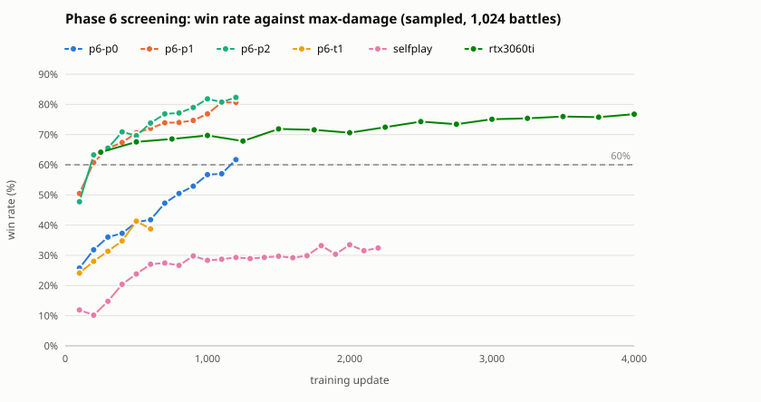
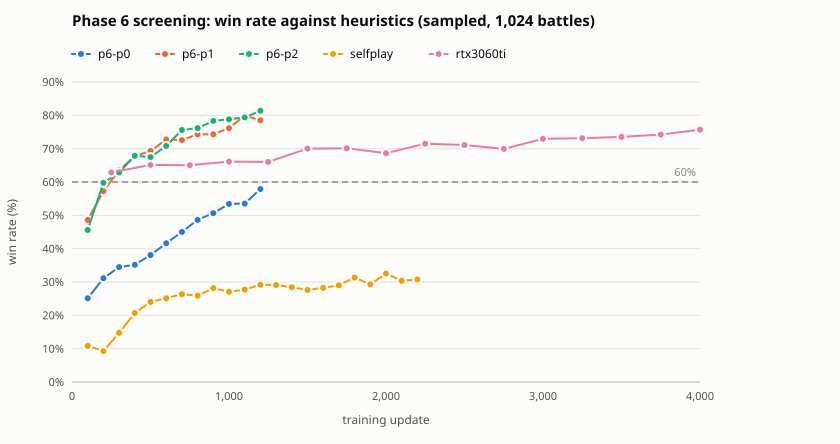
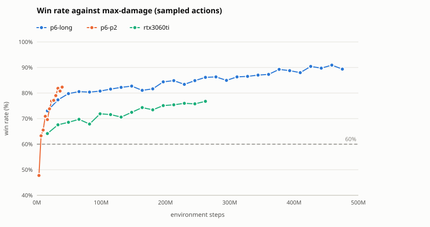
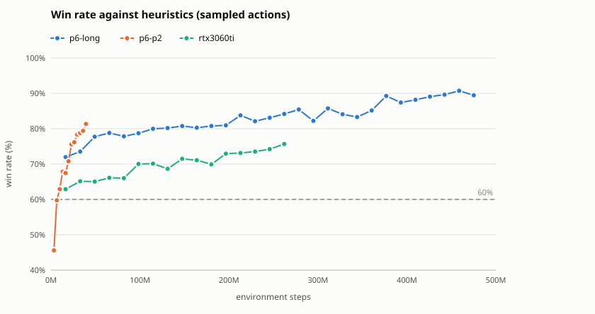

# Pokemon JAX

A JAX battle engine, RL environment and maskable Recurrent PPO for Pokemon
Showdown `gen5randombattle`. The plan and rules are in `ROADMAP.md`.

## Container

One image runs on the RTX 3060 Ti dev machine (Docker Desktop, WSL2 backend)
and on the RTX 6000 training machines (Docker with the NVIDIA Container
Toolkit). It has Python 3.13 with the pins from `requirements.txt` (JAX
0.12.0.1 for CUDA 13), Node 22, git, ripgrep, and two agent CLIs: Claude Code
(`claude`) and the Codex CLI (`codex`). The host needs an
NVIDIA driver that supports CUDA 13 (580 or newer); the CUDA libraries come
from pip. For a driver of 525 or newer (the lab's 550 hosts), build the CUDA 12 variant with
`--build-arg JAX_CUDA=cuda12`; `cuda12-driver550` pins the CUDA 12 libraries to older releases as a
fallback. The lab image is built with `--build-arg INSTALL_AGENTS=0`, which leaves out both agent CLIs.
The lab kit that runs on the RTX 6000 machines is described in `lab/README.md`.

Build (from the repo root):

```bash
docker build -t pokemon-jax .
```

Build arguments: `CLAUDE_CODE_VERSION` and `CODEX_VERSION` set the agent CLI
versions, and
`--build-arg USER_UID=$(id -u) --build-arg USER_GID=$(id -g)` on Linux makes
files written to the mounted repo belong to you.

Run with the repo mounted at `/workspace`. On Windows (PowerShell):

```powershell
docker run --rm -it --gpus all --mount "type=bind,source=K:\Pokemon JAX,target=/workspace" --mount "type=volume,source=pokemon-jax-claude,target=/home/developer/.claude" --mount "type=volume,source=pokemon-jax-codex,target=/home/developer/.codex" pokemon-jax
```

On Linux:

```bash
docker run --rm -it --gpus all --shm-size=2g -v "$(pwd)":/workspace -v pokemon-jax-claude:/home/developer/.claude -v pokemon-jax-codex:/home/developer/.codex pokemon-jax
```

Leave out `--gpus all` for CPU only; JAX then falls back to the CPU. The named
volumes keep the Claude Code and Codex logins between containers (sign in to
Codex with `codex login --device-auth`). The image sets no XLA allocator variable. The lab and `python -m pokejax.sizing` preallocate 90% of each GPU's memory per process (`XLA_PYTHON_CLIENT_PREALLOCATE=true`, `XLA_PYTHON_CLIENT_MEM_FRACTION=0.90`) unless you set those yourself; the tests set preallocation off. Other runs get JAX's default, or pass `-e XLA_PYTHON_CLIENT_PREALLOCATE=false` to share a GPU between processes.

Inside the container:

```bash
node reference/setup.cjs   # clone and build Showdown at the pinned commit
JAX_PLATFORMS=cuda python -c "import jax, jax.numpy as jnp; print(jax.devices()); print(jax.jit(lambda x: x @ x)(jnp.ones((256, 256))).devices())"
```

The second command fails instead of falling back to the CPU if JAX cannot see
the GPU. Expect one CUDA device on the dev machine.

## Environment

`pokejax/env.py` is the batched, functional environment (Phase 3). Host setup happens once in
the constructor; `reset` and `step` are pure, so they jit, vmap and scan:

```python
env = Env(EnvConfig(batch_size=4096, max_steps=1000, observe="both"), "work/teams/gen5-teams.npz")
env_state, timestep = jax.jit(env.reset)(key)
env_state, timestep = jax.jit(env.step)(env_state, actions)  # actions int [B, 2]
```

A battle that ends (win, loss, tie) or reaches the step cap is replaced inside the same step by
a fresh one with teams from the sampler. The time step has both sides' observations [B, 2, ...]
(`observe="none"` skips them), zero-sum rewards [B, 2] (win 1, loss -1, tie 0; optional
potential-based shaping with `shaping=True`), `terminated` and `truncated` [B], the observed
legal mask [B, 2, 9] and episode info (winner, length in steps and turns, illegal and refused
actions). `keep_final=True` also returns the observation before the reset. A hidden trap
(Shadow Tag, Arena Trap, Magnet Pull) refuses a switch as Showdown does: the step does not
advance, the refused side's mask loses its switches, and the other side's action is kept for the
next step. `OpponentEnv(env, opponent)` plays one random side per battle against a policy
function `(state, side, key) -> action` (random over the engine's legal mask by default) and
returns time steps of batch shape [B]. The module docstring has the details.

`pokejax/baselines.py` has four policies with that signature, chosen by name with
`make_policy(name, env.tables)`: `random` (uniform over the legal mask), `random-move` (uniform over the
legal moves, a switch only when none is legal), `max-damage` (power x STAB x effectiveness x accuracy x
hits x attack / defence, a switch only when it must) and `heuristics` (poke-env's
`SimpleHeuristicsPlayer`, commit bab3673). They are branch-free, read only what the player knows and
pick from the engine's true legal actions (hidden traps included), so none is ever refused. The
module docstring lists every interpretation of poke-env. `reference/baselines.cjs` is the same four
in Node, for `python -m pokejax.stats --policy0 NAME --policy1 NAME` and for the agreement check.

## Benchmarks

Run `python -m pokejax.bench --json` for the random legal policy, adding
`--batch-size 16384` to change the batch or `--with-observation` to observe
both sides. `--env` measures the environment of `pokejax.env` (sampler draws, auto-reset,
rewards, flags) with the random policy on both sides instead of the bare engine loop;
`--env --policy NAME` has both sides play that baseline from the state (`--policy1` gives side 1
another). The cold first call includes compilation and one rollout.

Measured 2026-11-17 on an NVIDIA GeForce RTX 3060 Ti, JAX 0.12.0.1,
HEAD `93a1b26fbbbd8bc0dbc527647b7a2bbc3e7ce7dd`:

| Batch | Mode | Cold first call (s) | Steps/s | Battles/s | Mean battle length (steps) |
|---:|---|---:|---:|---:|---:|
| 4,096 | Engine only | 4.65 | 25,134,430 | 355,907 | 70.70 |
| 16,384 | Engine only | 5.00 | 49,587,788 | 701,426 | 70.75 |
| 4,096 | Both observations | 5.05 | 12,374,399 | 175,471 | 70.70 |

The first row is the median of three fresh processes: cold first calls ranged
from 4.63 to 4.78 s, steps/s from 24,853,781 to 25,367,994, and battles/s
from 351,933 to 359,215. Each process reports the median of three warmed
rollouts. Cold compile under 60 s: pass. Engine throughput at batch 4,096
against the 5,000,000 steps/s target: pass.

In Phase 1, status moves, abilities and items do nothing, so later phases will
be slower.

### Phase 1 results

The differential tests passed the 40-battle fixture and the 300-battle set
(2 tests passed). The existing PPO smoke test won 3,883 of 4,096 battles
against random (94.80%, 95% Wilson CI 94.08–95.44%); random against random
won 50.95% (95% CI 49.42–52.48%). Training took 136.01 s and 9,830,400
environment steps.

### Phase 2 results

Gates, measured 2026-11-20 on an idle NVIDIA GeForce RTX 3060 Ti, JAX 0.12.0.1, with the
Phase 2 exit code (`python -m pokejax.bench --json`, batch 4,096, engine only, median of three
fresh processes, after performance pass 7): 3,419,031 steps/s (runs 3,404,191 to 3,425,404),
48,183 battles/s, mean battle length 70.99 steps, cold first call 29.05 s (29.01 to 29.20 s).
Cold compile under 60 s: pass. Engine throughput against the 3,000,000 steps/s target: pass
(the target was 5,000,000 until the owner lowered it at the end of Phase 2; see ROADMAP.md,
Gates). Throughput fell from 7.62M after performance pass 4 to 3.32M as tasks 11 to 14 added
the remaining mechanics. Performance pass 5 recovered 4%; a structural attempt (pass 6, a
working copy of the active Pokemon) did not help and was not committed; pass 7 (move identity
before row loads, prepared team inputs, shared damage facts) gained 3% and cut compile time.
The CPU cold compile at batch 64 is about 125 s.

Coverage (`COVERAGE.md`, generated): all 223 moves, 126 abilities and 44 items in the
10,000-team pool are supported, so 100.0% of teams are fully supported. The excluded set is
empty (0 teams, 0.0%). The team sampler (`pokejax/sampler.py`) draws only from supported
teams and computes its index array once on the host.

Differential recordings on unchanged pool teams: the 40-battle fixture
`tests/fixtures/diff-pool.jsonl.gz` matches 40 of 40 battles (2,609 decisions) and the
300-battle set `work/diff/pool.jsonl.gz` matches 300 of 300 (21,526 decisions). The other
fixtures and 300-battle sets still match completely. `python -m pytest -q tests --large`
passes 374 tests; `node --test tests/test-record-battles.cjs` passes 18.

Statistics (`python -m pokejax.stats --battles 4000 --unchanged --seed N`, pool teams exactly
as generated): with seed 1 and with seed 2 no statistic is flagged after Holm correction
(341 metrics each). The smallest raw p-values are 0.041 (seed 1, `move.agility`) and 0.064
(seed 2, `move.seedflare`). Showdown and the engine agree on side 0's win rate (Showdown
0.505 and engine 0.491 with seed 1; 0.504 and 0.497 with seed 2), mean battle length (Showdown
61.9 and engine 61.5 turns with seed 1; 62.3 and 62.3 with seed 2), faints per battle (9.95
and 9.98; 9.93 and 9.96) and status counts.

PPO smoke test (`python -m pokejax.ppo_smoke`, default configuration, 600 updates,
9,830,400 environment steps): the trained policy won 3,754 of 4,096 battles against random
(91.65%, 95% Wilson CI 90.76–92.46%); random against random won 49.88% (48.35–51.41%). Training
took 188.9 s on the RTX 3060 Ti, with no illegal actions.

### Phase 3 results

Gates, measured 2026-11-21 on an idle NVIDIA GeForce RTX 3060 Ti, JAX 0.12.0.1, with the
Phase 3 exit code, batch 4,096, median of three fresh processes each. Phase 3 exit measurement,
environment steps per second without observations (`python -m pokejax.bench --json --env --policy P`,
sampler draws, auto-reset, rewards and policy P on both sides):

| Policy on both sides | Steps/s | Runs | Mean battle length (steps) |
|---|---:|---|---:|
| random | 3,067,270 | 3,066,048 to 3,079,595 | 71.31 |
| random-move | 3,041,462 | 3,034,812 to 3,051,893 | 43.90 |
| max-damage | 3,025,314 | 3,020,785 to 3,026,324 | 27.46 |
| heuristics | 3,016,411 | 3,012,282 to 3,019,419 | 27.65 |

Each baseline runs at the 3,000,000 steps/s target: pass, with the thinnest margin 0.5%
(heuristics). The engine alone (`python -m pokejax.bench --json`) runs 3,077,254 steps/s
(3,072,321 to 3,096,411; 3,419,031 at the end of Phase 2). It lost 5% to the event record and
observation state of task 1 and 6% to the 41 engine defects fixed between tasks 1 and 2 (found by
fresh recordings with new seeds; see `tests/test_regress.py`). With both sides observed the
environment (random policies) runs 2,243,745 steps/s. Cold first call: 32.7 to 33.8 s, 35.3 s with
observations; cold compile under 60 s: pass.

After the Phase 6 review fixes the engine alone runs 2,831,828 and 2,857,718 steps/s (two runs),
below the 3,000,000 target: the Flame Body fix resolves multi-hit moves twice, about 5%. Training
is limited by the learner (about 78k steps/s), so this does not slow training. The owner accepted this 2.84M steps/s engine rate after the review fixes.

Observation (tasks 1 and 2). `observe` shows what one player can know at a decision point: the
own team in full, the opponent as revealed, both actives' public volatiles, weather, hazards, Trick
Room, pending Wish and Healing Wish, and a fixed record of the last step's visible events (action
order, move, miss, failure, critical hit, effectiveness, damage and healing in protocol percent, status,
faint). Durations that the protocol never states are not in it, only the turns since a public effect
started. The no-leak tests check that two states differing only in unrevealed opponent data or private
counters give the same observation. `reference/player-view.cjs` builds the same observation from one
player's requests and protocol lines alone, and `pokejax/obs_diff.py` compares every leaf with the
engine's at every decision point of recorded pool battles, for both sides: the 40-battle fixture
(2,649 decision points), the 300-battle set (21,826) and four more 300-battle seeds match completely.
The comparison found and fixed leaks (a benched foe's HP after Regenerator, Shadow Tag, Arena Trap and
Magnet Pull in the legal mask, a Transformed member's copied stats) and missing public facts (Knock Off,
Trick and stolen items). Illusion is the one carve-out: once the foe's Illusion holder has been active
(about 2.5% of battles) the protocol does not say which roster entry a disguised switch-in is, so the
opponent roster arrays of the two sides can legitimately differ and are not compared there.

Environment (task 3). `Env` runs a batch of battles with teams from the sampler and replaces a battle that
ended or hit the step cap inside the same step. It returns both sides' observations (or none),
zero-sum rewards (win 1, loss -1, tie 0; optional potential-based shaping, off by default),
`terminated` and `truncated` kept apart, the observed legal mask and episode statistics. A switch that
only a hidden trap forbids is refused as Showdown refuses it. `OpponentEnv` plays one random side per
battle against a policy function. The PPO smoke test (`python -m pokejax.ppo_smoke`, 600 updates,
9,830,400 environment steps) runs on it: the trained policy won 3,658 of 4,096 battles against random
(89.31%, 95% Wilson CI 88.32-90.22%); random against random won 49.56% (48.03-51.09%). Training took
222.2 s on the RTX 3060 Ti, with no illegal actions.

Baselines (task 4). The four policies of `pokejax/baselines.py` and the Node ones of
`reference/baselines.cjs` agree exactly. At every decision point of recorded unchanged pool battles
(`node reference/record-battles.cjs --profile pool --policies`) the Node max-damage and heuristics
policies choose an action for both sides from that player's own view, and `pokejax.baselines_diff`
replays the battle through the engine and compares it with the JAX choice: 0 of 10,596 choices differ
over the 40-battle fixture (`tests/fixtures/policy-pool.jsonl.gz`) and 0 of 87,304 over the 300-battle
set; no choice fell back to a random pick. Ties between candidates go to the first in request order
(Showdown's `side.pokemon` order, which `BattleState.party` tracks), so the check is sensitive to it:
ascending team slots instead make 29 choices of the fixture differ. Interpretations of poke-env that the
policies make, beyond the brief: Hidden Power counts as the typed power 70 move (the Gen 5 table row has
power 0), the entry-hazard branch sees only Spikes and Toxic Spikes, ties are scores within 1e-5, and the
setup-move branch is ported but off because poke-env's `move.target == "self"` compares an enum with a
string and is never true at the pinned commit. Enabling it in both implementations still agrees
(0 of 87,304); it changes 227 of the 5,298 heuristics choices of the fixture (4%).

Whole-battle statistics on the unchanged pool teams (`python -m pokejax.stats --battles 4000 --unchanged
--seed N --policy0 A --policy1 B`, the same team pairs in both simulators). Side 0's win rate in
Showdown and in the engine, and the two-proportion test of the difference:

| Side 0 against side 1 | Seed | Showdown | Engine | Difference (SE) | p | Turns Showdown / engine | Flagged (metrics) |
|---|---:|---:|---:|---:|---:|---:|---|
| random-move against random | 1 | 0.9235 | 0.9193 | +0.0042 (0.0060) | 0.48 | 38.60 / 38.38 | none (337) |
| random-move against random | 2 | 0.9187 | 0.9163 | +0.0025 (0.0062) | 0.68 | 38.60 / 38.71 | none (340) |
| max-damage against random | 1 | 0.9812 | 0.9832 | -0.0020 (0.0030) | 0.50 | 24.64 / 24.45 | none (338) |
| max-damage against random | 2 | 0.9842 | 0.9832 | +0.0010 (0.0028) | 0.72 | 24.82 / 24.69 | none (339) |
| heuristics against random | 1 | 0.9850 | 0.9858 | -0.0008 (0.0027) | 0.78 | 24.27 / 23.93 | none (337) |
| heuristics against random | 2 | 0.9872 | 0.9875 | -0.0003 (0.0025) | 0.92 | 24.30 / 24.34 | none (339) |
| heuristics against max-damage | 1 | 0.5268 | 0.5225 | +0.0043 (0.0112) | 0.70 | 18.43 / 18.40 | none (336) |
| heuristics against max-damage | 2 | 0.5140 | 0.5235 | -0.0095 (0.0112) | 0.40 | 18.63 / 18.75 | none (337) |

No metric of any run is flagged after Holm correction (battle length, its distribution, faints,
switches, Struggle, confusion, statuses, and the use counts of every move and consumed item). The
smallest raw p-values are 0.018 to 0.087 (one per run, a different metric each time: for example
`status.par` 0.044 with seed 1 for max-damage against random, which is 0.81 with seed 2). Random
against random, for the Phase 2 comparison, is under Phase 2 results.

### Phase 4 results

Exit check (ROADMAP.md, Phase 4): beats max-damage in well over half of evaluation games, and the
training curve is still improving. The chosen run, `configs/rtx3060ti.toml`, won 76.49% of 4,096
battles against max-damage with sampled actions (95% Wilson CI 75.17 to 77.76) and 78.64% with greedy
actions (77.36 to 79.87). Against heuristics it won 75.00% and 76.83%. The curve rose from 70.6% at
update 2,000 to 76.8% at update 4,000 (1,024 battles per point), but the last 1,000 updates gained
about 1.7 points against a CI of about plus or minus 3, so the late rise is a slope, not a confirmed
trend (see "Still improving" below).

Setup (run directory `work/runs/rtx3060ti`, outside git; console log `work/codex/runs/rtx3060ti-console.log`):

- Configuration: `configs/rtx3060ti.toml`, run with `XLA_PYTHON_CLIENT_PREALLOCATE=true
  XLA_PYTHON_CLIENT_MEM_FRACTION=0.90` (the lab's allocator settings; the default allocator ran out of
  memory at 2,048 rows in the experiments).
- Network: GRU core of 256, trunk of 256, member encoder of 64, 741,659 parameters. Public damage and
  matchup features (`network.features`: each move slot's power, accuracy, STAB, type effectiveness
  against the opponent's current types and max-damage score; each switch's matchup and threat; the
  threat to the active member) and a per-action policy head (`network.action_head = "factored"`: one
  scorer for the move slots and one for the switches, width 64).
- Rows: 1,024 battle rows per update: 384 self-play (768 lanes), 256 pool rows (a pool of 8 past
  parameter sets, refreshed every 50 updates), 64 random, 64 random-move, 128 max-damage and 128
  heuristics. 1,408 learner lanes.
- Rollout 64 steps, sequences of 16, 4 epochs of 4 minibatches, learning rate 1e-3 decaying linearly
  to 1e-4 over the run (4,000 updates), gamma 0.99, GAE lambda 0.95, clip 0.2, entropy coefficient 0.01.
- Throughput (median of the update times, 4,000 updates): 78,383 environment steps per second of
  training (65,536 steps per update); the environment alone (random legal actions, no network) runs 401,159 steps per second on the same
  settings. The first update, which compiles, took 61.7 s.
- GPU memory: 1.60 GB peak (`peak_bytes_in_use`).
- Wall time: 3,620 s of training, including the 16 evaluations (every 250 updates, 1,024 battles per
  baseline and policy) and the checkpoints, then about 2 minutes for the final evaluation of 4,096
  battles per baseline and policy.

Evaluation curve (win rate %, sampled / greedy, 1,024 battles per cell):

| Update | random | random-move | max-damage | heuristics |
|---:|---|---|---|---|
| 250 | 98.5 / 99.1 | 89.5 / 92.4 | 64.2 / 68.7 | 62.9 / 64.6 |
| 500 | 98.9 / 99.1 | 91.1 / 93.1 | 67.6 / 70.6 | 65.1 / 67.9 |
| 750 | 99.1 / 99.4 | 92.1 / 93.8 | 68.6 / 69.9 | 65.0 / 68.7 |
| 1000 | 99.1 / 99.4 | 92.2 / 94.4 | 69.7 / 72.1 | 66.1 / 68.4 |
| 1250 | 99.2 / 99.5 | 93.1 / 95.1 | 67.9 / 72.7 | 66.0 / 70.9 |
| 1500 | 99.2 / 99.0 | 95.1 / 95.9 | 71.9 / 72.8 | 70.0 / 71.4 |
| 1750 | 98.5 / 99.6 | 93.9 / 96.3 | 71.6 / 73.9 | 70.1 / 71.0 |
| 2000 | 99.6 / 99.2 | 93.8 / 95.2 | 70.6 / 72.3 | 68.7 / 72.4 |
| 2250 | 98.9 / 99.0 | 95.6 / 96.4 | 72.5 / 72.9 | 71.5 / 71.9 |
| 2500 | 98.9 / 99.4 | 94.8 / 96.4 | 74.3 / 73.2 | 71.1 / 71.5 |
| 2750 | 99.2 / 99.4 | 94.3 / 96.6 | 73.4 / 74.3 | 69.9 / 73.8 |
| 3000 | 98.7 / 99.2 | 94.4 / 95.4 | 75.1 / 76.2 | 72.9 / 74.3 |
| 3250 | 98.8 / 99.6 | 95.0 / 95.7 | 75.4 / 76.7 | 73.1 / 76.3 |
| 3500 | 99.4 / 99.8 | 95.3 / 96.5 | 76.0 / 77.1 | 73.5 / 75.2 |
| 3750 | 99.1 / 99.6 | 96.5 / 96.5 | 75.8 / 76.1 | 74.2 / 75.5 |
| 4000 | 99.3 / 99.8 | 96.6 / 96.7 | 76.8 / 77.7 | 75.7 / 77.7 |

Final evaluation (4,096 battles per row; learner sides alternate; Wilson 95% intervals):

| Opponent | Policy | Win rate % | 95% Wilson CI % | Wins / battles |
|---|---|---:|---|---:|
| heuristics | greedy | 76.83 | 75.51 to 78.10 | 3147 / 4096 |
| heuristics | sampled | 75.00 | 73.65 to 76.30 | 3072 / 4096 |
| max-damage | greedy | 78.64 | 77.36 to 79.87 | 3221 / 4096 |
| max-damage | sampled | 76.49 | 75.17 to 77.76 | 3133 / 4096 |
| random | greedy | 99.58 | 99.34 to 99.74 | 4079 / 4096 |
| random | sampled | 99.29 | 98.99 to 99.51 | 4067 / 4096 |
| random-move | greedy | 96.02 | 95.38 to 96.58 | 3933 / 4096 |
| random-move | sampled | 95.63 | 94.96 to 96.21 | 3917 / 4096 |

The plot of the curve against max-damage and heuristics (sampled, with the 60% exit target) is
`docs/phase4-curve.svg`.

Still improving. The curve against max-damage (sampled) reads 70.6% at update 2,000,
75.1% at 3,000, 76.0% at 3,500, 75.8% at 3,750 and 76.8% at 4,000; against heuristics it reads
68.7%, 72.9%, 73.5%, 74.2% and 75.7%. Both rose over the run, and the
learning rate reached its floor at the end. Over the last 1,000 updates the rise is about
1.7 points against max-damage, inside the CI of a 1,024-battle point
(about plus or minus 3). We report it as a slope, not as a confirmed trend: the 4,096-battle
evaluation is the figure to quote.

A longer decay did not help by 2,000 updates. A first run with the same settings but a 12,000-update decay
(`work/runs/rtx3060ti-h12000-stopped`, stopped at update 2,210) kept the rate near 9e-4 for thousands of
updates: its curve against max-damage was 71.9% (sampled) at 1,000 updates, 70.1% at 1,500 and 68.6% at 2,000,
with KL growing from 0.004 to 0.013 per update and the clip fraction from 0.035 to 0.077. The 4,000-update
decay (the chosen run) reached 75.1% at 3,000 updates. The stopped run is kept in work/ and is not
evaluated further.

Diagnosis (before the change). The 2,200-update self-play run (`configs/selfplay.toml`, the part 2
run) stalled at 26% to 34% against max-damage from update 600 on. Its training logs say the update was
small (approximate KL 0.0003 to 0.003 per update, clip fraction 0.002 to 0.02), the entropy fell from
1.77 to 0.33, and the explained variance held near 0.6. Replaying its checkpoint against max-damage
(`work/codex/diag/diag_policy.py`, decision by decision, with the max-damage choice and the public damage
numbers for the same position) gave these numbers, which also show what the change did:

| Diagnostic, greedy, 512 rows x 300 steps (about 5,000 battles) | selfplay, 2,200 updates | E4, 1,200 updates | chosen, 4,000 updates |
|---|---:|---:|---:|
| learner win rate in these battles | 35.2% | 76.7% | 79.0% |
| move chosen equal to max-damage's move, when both pick a move | 48.0% | 70.2% | 63.2% |
| policy's top action equal to max-damage's action | 43.9% | 64.5% | 58.2% |
| probability the policy gives max-damage's action (mean) | 0.44 | 0.59 | 0.53 |
| super-effective share of move choices (max-damage: 29.1%, 35.9%, 35.3%) | 13.1% | 36.1% | 33.1% |
| resisted or immune move chosen when a neutral or super option exists | 20.5% | 4.1% | 5.9% |
| chosen move's max-damage score over the best legal one (mean) | 0.64 | 0.73 | 0.68 |
| pairs of moves ordered the same way by the policy logits and max-damage scores | 0.69 | 0.74 | 0.71 |
| status move chosen when a damaging move is legal | 15.4% | 19.6% | 25.1% |
| voluntary switches (max-damage: never) | 2.5% | 11.8% | 11.7% |
| voluntary switches to the best legal matchup | 46% | 81% | 81% |

Reading. The network saw the moves only as 16-dimensional embeddings of their IDs, so the product of
power, type, STAB, accuracy and the boosted attack ratio had to be built by the trunk from scratch; it
partly managed (ordering agreement 0.69), but it used super-effective moves about half as often as max-damage
and switched almost never. With the public damage and matchup features as inputs, and a head that scores
each move slot and each switch from its own features, the same agent picks max-damage's move in about
two of three positions and uses super-effective moves nearly as often as max-damage does.
The learning rate was the second bottleneck: at 3e-4 the approximate KL per update was about 0.001, and the
run at 1e-3 reached 67% against max-damage at 300 updates against 63% at 3e-4 (experiments E3 and E4).

Experiments (one seed, 1,024 battles per point, so differences under about 3 points are noise). Each short
run is about 1,200 updates (20 to 25 minutes on the RTX 3060 Ti); the trials that were stopped early are
marked. The final column is the run's own 4,096-battle evaluation.

| Run | What changed from `selfplay.toml` | Updates (minutes) | max-damage at 300 / 600 / 1,000 (sampled / greedy) | Final max-damage, 4,096 battles (sampled / greedy) | Final heuristics (sampled / greedy) |
|---|---|---:|---|---|---|
| E0 `selfplay.toml` | none (dense head, lr 3e-4 to 3e-5, 1,024 rows) | 2,200 (30.6) | 14.7 / 15.8, 27.1 / 27.5, 28.3 / 30.1 | 31.9 / 32.1 | 30.9 / 31.9 |
| E1 | features and factored head | 1,200 (22.2) | 63.1 / 63.7, 65.2 / 67.2, 67.7 / 66.5 | 68.0 / 70.0 | 65.1 / 68.5 |
| E2 | E1 with 2,048 rows | 810, stopped (26.5) | 64.2 / 66.8, 66.7 / 67.6, (800: 69.4 / 68.0) | not run to the end | not run to the end |
| E3 | E1 with max-damage and heuristics at 12.5% each (selfplay 37.5%) | 1,200 (21.1) | 63.1 / 64.7, 65.6 / 67.0, 68.6 / 68.4 | 68.1 / 70.4 | 65.4 / 68.6 |
| E4 | E3 with lr 1e-3 to 1e-4 | 1,200 (21.1) | 67.0 / 67.1, 69.6 / 70.7, 73.9 / 75.6 | 74.9 / 77.2 | 72.2 / 74.3 |
| E5 | E3 with lr 2e-3 to 2e-4 | 1,060, stopped (19.0) | 63.8 / 65.8, 65.9 / 70.7, 66.7 / 72.0 | not run to the end | not run to the end |
| L1 | E4 with a 12,000-update decay | 2,210, stopped (34.9) | 66.2 / 69.8, 71.9 / 73.0 (1,000), 68.6 / 71.2 (2,000) | not run to the end | not run to the end |
| L2 (chosen) | E4 with a 4,000-update decay: `configs/rtx3060ti.toml` | 4,000 (62) | 64.2 / 68.7, 69.7 / 72.1, 75.1 / 76.2 (3,000) | 76.5 / 78.6 | 75.0 / 76.8 |

The 2,048-row run (E2) gave the same curve per update at 1.8 times the time per update, so 1,024 rows
stayed. Raising the max-damage and heuristics shares (E3) changed nothing measurable, but kept those
groups at 128 rows each, so it stayed. Raising the learning rate to 2e-3 (E5) was worse than 1e-3 by
the 1,000-update point. The chosen setup is E4's, with a 4,000-update decay.

Lab kit (lab/README.md). The smoke test with the RTX 6000 configuration on this 8 GB card (`LAB_SMOKE=1
lab/run.sh`, `configs/rtx6000.toml`): preflight, facts, bench (3 measurements) and the sweep (1 cell, batch 1,024) completed; contention and the training probe ran out of memory at 16,384, 8,192 and 4,096 rows, since one allocation of the 4,096-row arena is above the 3 to 4 GiB this card allows (the part 1 finding), so the lab stopped those steps as its fallback ladder ends there. The pack step wrote `work/lab-results/2026-11-22-fee70b24e9c5-5.tar.gz`, and the lab exited 1 with "lab run not complete", which the brief accepts for this card. On the RTX 6000 the first rung, 16,384 rows, is the one expected to run.

Caveats. The features read the observation only, so no hidden information enters them, and tests cover that
(`tests/test_train_features.py`). One exception to matching max-damage: Hidden Power's type depends on
the Pokemon's IVs, which the observation does not carry, so the features count it as a Normal move of
power 70. The max-damage scores agree with the baseline to 1e-4 everywhere else (checked on real battles).
The evaluation battles use fixed keys, so every checkpoint of a run plays the same battles.

### Feature ablations

Question: how much of the Phase 4 result comes from the two kinds of column the owner asked about, the max-damage score of each move and poke-env's matchup estimate of each switch? Four runs of E4 differ only in the network's inputs. A has no public features and the dense head (the network of E0). `dex` (B) keeps the move table and the public types, and each switch's legality, HP, offence and defence estimates; it drops the max-damage scores, the speed, matchup and threat columns and the active member's threat. `dex-no-matchup` (B2) also drops the switches' offence and defence. The inputs are chosen by `network.feature_set` (`full` by default, so no existing configuration changed; the columns are in `pokejax/train/features.py`). Each run is 1,200 updates with the settings of E4 (the E3 opponent shares, learning rate 1e-3 decaying to 1e-4, 1,024 rows, rollouts of 64 steps, seed 0), evaluated every 100 updates with 1,024 battles and finally with 4,096 battles per row. The configurations are `work/codex/exp/abl-a.toml`, `abl-b.toml` and `abl-b2.toml`; the run directories `work/runs/abl-a`, `abl-b` and `abl-b2` (outside git). C is E4 itself (`work/runs/exp-f4`, not rerun), and E0 (`work/runs/selfplay`) is shown for reference with its own settings.

| Run | Inputs | Final vs max-damage, 4,096 battles: sampled / greedy (95% Wilson interval) | Final vs heuristics | Final vs random-move | Final vs random | Max-damage at 300 / 600 / 1,000 / 1,200 (sampled / greedy) | Training minutes | Parameters |
|---|---|---|---|---|---|---|---:|---:|
| A (`abl-a`) | none, dense head | 32.03 (30.62 to 33.48) / 32.84 (31.42 to 34.29) | 31.18 (29.78 to 32.61) / 31.57 (30.16 to 33.01) | 80.27 (79.03 to 81.46) / 81.76 (80.55 to 82.92) | 97.24 (96.69 to 97.70) / 98.46 (98.04 to 98.80) | 27.93 / 25.59 · 26.27 / 28.81 · 28.81 / 29.49 · 30.27 / 33.50 | 17.9 | 686,882 |
| B (`abl-b`) | `dex` (move table, public types, PP, HP; switch legal and HP, offence, defence), factored head | 70.85 (69.44 to 72.22) / 74.51 (73.15 to 75.82) | 68.97 (67.54 to 70.37) / 71.75 (70.35 to 73.11) | 93.99 (93.22 to 94.68) / 94.80 (94.08 to 95.44) | 99.22 (98.90 to 99.45) / 99.54 (99.28 to 99.70) | 64.55 / 68.75 · 65.23 / 68.36 · 67.87 / 72.27 · 69.92 / 73.93 | 21.4 | 733,851 |
| B2 (`abl-b2`) | `dex-no-matchup` (as B, switch legal and HP only), factored head | 54.47 (52.94 to 55.99) / 56.67 (55.14 to 58.18) | 53.42 (51.89 to 54.94) / 55.15 (53.62 to 56.67) | 92.21 (91.35 to 92.99) / 90.82 (89.90 to 91.67) | 98.85 (98.48 to 99.14) / 99.37 (99.07 to 99.57) | 45.41 / 48.14 · 48.44 / 51.95 · 50.20 / 53.03 · 52.34 / 55.08 | 22.4 | 731,163 |
| C = E4 (`exp-f4`) | all columns (max-damage scores, matchup estimates, threat), factored head | 74.93 (73.58 to 76.23) / 77.20 (75.89 to 78.46) | 72.24 (70.85 to 73.59) / 74.29 (72.93 to 75.61) | 95.26 (94.57 to 95.87) / 95.36 (94.67 to 95.96) | 99.17 (98.84 to 99.41) / 99.34 (99.04 to 99.55) | 66.99 / 67.09 · 69.63 / 70.70 · 73.93 / 75.59 · 74.80 / 76.46 | 21.1 | 741,659 |
| E0, reference (`selfplay`) | none, dense head; its own settings (2,200 updates, lr 3e-4 to 3e-5) | 31.86 (30.45 to 33.30) / 32.10 (30.69 to 33.55) | 30.88 (29.49 to 32.32) / 31.93 (30.52 to 33.38) | 81.69 (80.48 to 82.84) / 82.35 (81.15 to 83.49) | 97.61 (97.09 to 98.03) / 97.83 (97.33 to 98.23) | 14.75 / 15.82 · 27.05 / 27.54 · 28.32 / 30.08 · 29.30 / 28.81 | 30.6 | 686,882 |


The points are evaluations (1,024 battles, sampled actions); the dashed line is 60%. Colours are fixed per run: C (`exp-f4`) blue, A (`abl-a`) orange, B (`abl-b`) aqua, B2 (`abl-b2`) yellow and E0 (`selfplay`) magenta. No run is still rising beyond the noise at 1,200 updates: the last three evaluation points against max-damage (sampled, 1,000 / 1,100 / 1,200) are A 28.8, 30.3, 30.3; B 67.9, 67.5, 69.9; B2 50.2, 54.1, 52.3; C 73.9, 72.1, 74.8.

Without the public features, on the dense head, the agent stays at about 32% against max-damage (E0: 31.9%), against 54.5% with the move and type inputs alone (B2) and 70.9% with the switch offence and defence estimates too (B). The max-damage scores and the other estimate columns add about 4 points more (C, 74.9%), and the switch offence and defence estimates add about 16 on top of the move and type inputs (B over B2). A and B also differ in the action head, and each arm is one seed, so these are the sizes of the effects, not a clean split between inputs and head.

### Phase 5 results

The Phase 4 checkpoint (`work/runs/rtx3060ti`) played in the pinned local Showdown simulator through
the bridge (`reference/showdown-player.cjs`, `python -m pokejax.showdown`) against the Node
baselines, next to the engine's evaluation of the same checkpoint on the same team pairs and learner
sides (`python -m pokejax.showdown.compare --checkpoint work/runs/rtx3060ti --battles 4096`). 4,096
battles per row, JAX on the CPU (the GPU was in use), Wilson 95% intervals.

| Opponent | Policy | Engine win % | Showdown win % | Difference (points) |
|---|---|---|---|---:|
| random | sampled | 99.29 [98.99, 99.51] | 99.73 [99.52, 99.85] | +0.44 |
| random | greedy | 99.58 [99.34, 99.74] | 99.58 [99.34, 99.74] | +0.00 |
| random-move | sampled | 95.63 [94.96, 96.21] | 95.90 [95.25, 96.46] | +0.27 |
| random-move | greedy | 96.02 [95.38, 96.58] | 96.66 [96.06, 97.16] | +0.63 |
| max-damage | sampled | 76.56 [75.24, 77.83] | 77.17 [75.86, 78.43] | +0.61 |
| max-damage | greedy | 78.56 [77.28, 79.79] | 78.83 [77.56, 80.06] | +0.27 |
| heuristics | sampled | 75.05 [73.70, 76.35] | 75.05 [73.70, 76.35] | +0.00 |
| heuristics | greedy | 76.68 [75.36, 77.95] | 77.29 [75.99, 78.55] | +0.61 |

Exit: within 3 points against each baseline with at least 4,000 battles a side; the largest gap is
0.63 points, so it passes. Over all 32,768 Showdown battles: 0 errors, 0 disagreements between the
observed legal mask and Showdown's request, 0 truncations; refused trapped switches 3.6 to 5.1 per 100
battles, the same size as in the engine; mean battle length within 0.3 steps. The first observation of
every battle matches the engine's leaf for leaf (floats within 1 ulp: XLA divides by multiplying with
a reciprocal). Showdown is ahead by +0.35 points on average (6 of 8 rows positive, none negative);
individually only random/sampled is significant (p = 0.003). On the GPU the same comparison gave a
largest gap of 1.51 points. Showdown battles run at about 45 per second in one Node process.

### Phase 6 screening

Question: does a network that reads only the public observation and the dex, with the pairwise
interaction of each move against each defender, learn the type chart and play better than a control
with the same inputs and no pair module, and do the auxiliary losses on hidden state help? Three arms,
one seed each, with the league and schedule of the chosen Phase 4 run: P0 is the control (per-action
scorers, no pair module), P1 the pairwise network, P2 the pairwise network with four auxiliary losses
(next action 0.05, hidden item 0.01, ability 0.01, moves 0.03). T1 (Phase 6 task 3) is the recurrent
roster transformer (design 2 of `work/codex/design-sol.md`: 19 tokens of width 96, three attention
blocks, four heads, a 128-unit GRU on the field token), with P2's four auxiliary losses and otherwise
P2's configuration. All use 512 battle rows, 64-step rollouts, a learning rate from 1e-3 to 1e-4 over
1,221 updates (about 40M environment steps), evaluations every 100 updates with 1,024 battles, and final
evaluations with 4,096 battles per row. The configurations are `work/codex/exp/p6-p0.toml` to
`p6-p2.toml` and `p6-t1.toml`; the run directories `work/runs/p6-p0` to `p6-p2` and `p6-t1` (outside
git). The type probe reads each arm's frozen move features and reports macro recall of the chart
multiplier (`python -m pokejax.train.probe`).

| Arm | Parameters | XLA FLOPs per forward | Steps/s | Peak device memory | Training minutes | Max-damage, 20M (sampled) | Max-damage, 40M sampled (greedy) | Heuristics, 40M sampled (greedy) | Random-move, 40M sampled |
|---|---:|---:|---:|---:|---:|---:|---:|---:|---:|
| P0 control | 307,659 | 1.43M | 58k | 886 MiB | 20.1 | 45.39 (43.87 to 46.91) | 61.40 (59.90 to 62.88) (63.09) | 59.35 (57.84 to 60.85) (60.96) | 92.53 (91.68 to 93.30) |
| P1 pairwise | 327,499 | 4.01M | 34k | 2,145 MiB | 28.9 | 73.83 (72.46 to 75.15) | 81.01 (79.78 to 82.18) (83.11) | 80.15 (78.90 to 81.34) (82.62) | 97.36 (96.83 to 97.81) |
| P2 pairwise + aux | 442,519 | 4.01M | 31.6k | 2,205 MiB | 30.7 | 74.90 (73.55 to 76.21) | 83.40 (82.23 to 84.51) (85.67) | 81.49 (80.28 to 82.65) (83.52) | 97.22 (96.67 to 97.68) |
| T1 transformer + aux | 523,415 | 10.04M | 14.4k | 1,657 MiB | 28.2 (20M only) | 41.36 (39.86 to 42.87) (43.90) | not run | not run | not run |
| T1b transformer + aux, learning rate 3e-4 to 3e-5 | 523,415 | 10.04M | 14.3k | 1,656 MiB | 28.3 (20M only) | 62.06 (60.56 to 63.53) (63.89) | not run | not run | not run |

Steps per second are the training rates of the 512-row runs, measured alone on the GPU (the phase
averages; T1's is its 20M phase). The XLA count is the cost analysis of one lane's policy forward (the
design's arithmetic count of the pairwise network is 3.75M; of the transformer, 4.89M multiply-adds for
policy and value). Training minutes are the `training_seconds` of the phases (both phases for P0 to P2;
they include the evaluations inside the loop). Peak device memory is `peak_device_bytes` of the 512-row
runs (the table's P2 figure is its 40M run; at 20M the same measure gives P0 886 MiB, P1 2,145 MiB, P2
2,209 MiB and T1 1,657 MiB). T1's first update ran out of GPU memory with its attention activations stored for
the whole replay minibatch (a 4.2 GiB temporary buffer), so its attention blocks are rematerialised in the
backward pass, and its move projection covers only the own active's four moves.

| Arm | Probe at 20M or 40M, macro recall, species and moves (trained / random init) | Probe, dual pairings | Immunity recall (trained / random init) | Resisted and super-effective confusions (trained / random init) | Auxiliary heads, training batches (last 10 logged updates) |
|---|---:|---:|---:|---:|---|
| P0 control, 40M | 0.431 / 0.366 | 0.355 / 0.285 | 0.556 / 0.446 | 0.106 / 0.109 | - |
| P1 pairwise, 40M | 0.630 / 0.342 | 0.540 / 0.263 | 0.635 / 0.642 | 0.007 / 0.086 | - |
| P2 pairwise + aux, 40M | 0.588 / 0.328 | 0.491 / 0.246 | 0.645 / 0.567 | 0.010 / 0.093 | next action: kind 0.90, identity 0.64; item 0.84; ability 0.96; moves precision 0.35, recall 1.00 |
| P2 pairwise + aux, 20M | 0.603 / 0.349 | 0.575 / 0.311 | 0.696 / 0.627 | 0.016 / 0.088 | next action: kind 0.88, identity 0.60; item 0.84; ability 0.96; moves precision 0.29, recall 1.00 |
| T1 transformer + aux, 20M | 0.469 / 0.313 | 0.370 / 0.274 | 0.571 / 0.456 | 0.050 / 0.106 | next action: kind 0.93, identity 0.55; item 0.83; ability 0.96; moves precision 0.29, recall 1.00 |
| T1b transformer + aux, 20M, learning rate 3e-4 to 3e-5 | 0.551 / 0.302 | 0.451 / 0.300 | 0.705 / 0.431 | 0.039 / 0.101 | next action: kind 0.91, identity 0.58; item 0.83; ability 0.96; moves precision 0.18, recall 1.00 |

The probe fits a regularised linear six-class read-out of the chart multiplier {0, 1/4, 1/2, 1, 2, 4} on the
frozen move features, with species and move IDs (or dual-type pairings) held out. Immunity recall is high
for the random networks too (0.45 to 0.64, few rows), so it does not separate the arms. The auxiliary
figures are training-batch statistics, not held-out ones. The 20M rows use the 20M snapshot of each run.





T1 stopped at 20M. Against max-damage it scored 41.36% (4,096 battles, 39.86 to 42.87) against P2's 74.90%
at 20M, 33.5 points behind, which is past the task's stop line of 10 points, so its phase 2, its 40M probe
and its 40M Showdown checks were not run. Its periodic evaluations against max-damage at 400, 500 and 600
updates were 34.8, 41.3 and 38.8 (P2: 70.9, 69.6 and 73.8), and its training was less steady: at update 100
the approximate KL was 0.045 with a clip fraction of 0.25 (P2: 0.007 and 0.08), and the gradient norm was
about 2.5 times P2's. At 20M its frozen features carry the chart less well than P2's (species and moves macro
recall 0.47 against 0.60, dual pairings 0.37 against 0.58). Per step it costs 2.2 times P2's time (14.4k
against 31.8k steps per second) and 2.5 times its forward FLOPs (10.0M against 4.0M). The Showdown player runs
the 20M checkpoint: 256 greedy battles against max-damage gave 46.5% (40.5 to 52.6) with no errors, illegal
picks or mask mismatches, and first observations identical to within one float ulp.

T1b, the same transformer at learning rate 3e-4 decaying to 3e-5 (one seed), was stopped at 20M by the same rule: 62.06% against max-damage (4,096 battles, 60.56 to 63.53), 12.8 points behind P2's 74.90%, so its phase 2 and its 40M checks were not run. The lower rate removed T1's early instability (approximate KL at update 100: 0.0073, against 0.045 for T1 and 0.0072 for P2), but its gradient norm stayed about 2.5 times P2's.

The pairwise network (P1) beats the control (P0) by 19.6 points against max-damage at 40M steps (81.0% against
61.4%, one seed each), and its frozen move features carry the chart multiplier far above its random
initialisation (macro recall 0.63 against 0.34), where the control's do not (0.43 against 0.37). The four
auxiliary losses (P2) add 2.4 points against max-damage and 1.3 against heuristics, with intervals that only just stop overlapping
(82.2 to 84.5 against 79.8 to 82.2) on max-damage, but they do not improve the chart read-out. P0 was still rising at 40M (56.7, 57.0 and 61.7
against max-damage at updates 1,000, 1,100 and 1,200), P1 rose 3.8 points over those three evaluations but
was flat over the last two, and P2 was flat (81.8, 80.8 and 82.3).

### Phase 6 results

The Phase 6 exit (ROADMAP.md) is met by the long run of P2, the pairwise network with the four
auxiliary losses, on one training seed. The run is `work/codex/exp/p6-long.toml` (outside git, run
directory `work/runs/p6-long`): P2's configuration (512 battle rows of 64 steps, the league of
`configs/rtx3060ti.toml`, the four auxiliary losses) with 14,650 updates, which is 480,051,200
environment steps, and a learning rate that decays linearly from 1e-3 to 1e-4 over the whole run. It
ran alone on the RTX 3060 Ti from 01:29:17 to 05:46:49 UTC on 2026-11-24, once, without a stop or a
resume. The kept checkpoints (`checkpoint-<update>.npz`, never overwritten, selected by
`checkpoint.keep`) are at 3,662 updates (119,996,416 steps, "120M"), 7,325 updates (240,025,600
steps, X = 240M, fixed before the run), 9,767 updates (320,045,056 steps, two thirds of the run, "320M")
and 14,650 updates (480,051,200 steps, 2X, "480M").

Exit table (4,096 battles per evaluation; sampled actions, greedy in brackets):

| Exit item | Measured | Result |
|---|---|---|
| At least 60% against max-damage and heuristics, lower 95% bound above 55% | max-damage 91.09% [90.18, 91.92] (greedy 91.36% [90.46, 92.18]); heuristics 90.23% [89.29, 91.11] (greedy 90.87% [89.95, 91.71]) | pass |
| At least 55% against its own checkpoint from two thirds of the run | 480M against 320M: 66.39% [65.36, 67.41] sampled, 66.09% [65.06, 67.11] greedy, over 8,192 games (4,096 team draws, each played on both seats) | pass |
| Still improving: 2X beats X by at least 2 points, positive 95% interval (panel, X = 240M) | panel mean, 480M minus 240M: +6.26 points [+5.65, +6.87] sampled, +5.01 [+4.40, +5.59] greedy | pass |
| Fits in 12 hours on the 3060 Ti | 15,350 s of training, evaluations and checkpoints included (4 h 16 min); 15,452 s (4 h 17 min 32 s) from launch to the end of the final evaluation | pass |
| Changing the type chart table does not change the network's inputs | `tests/test_train_roster.py::test_changing_the_type_chart_changes_no_input_of_the_roster_networks` | pass |
| Phase 5 transfer of the promoted (480M) checkpoint: within 3 points per baseline, at least 4,000 battles each | largest gap 1.00 points (heuristics, sampled: engine 90.23%, Showdown 89.23%); 4,096 battles per row and simulator, 0 errors, all eight rows within 3 points | pass |

The final evaluation of the 480M checkpoint, written by the run (`pokejax.train.evaluation` with
Wilson intervals, `work/runs/p6-long/result.json`):

| Opponent | Sampled | Greedy |
|---|---:|---:|
| random | 99.88 [99.71, 99.95] | 99.80 [99.62, 99.90] |
| random-move | 98.75 [98.37, 99.05] | 98.71 [98.31, 99.01] |
| max-damage | 91.09 [90.18, 91.92] | 91.36 [90.46, 92.18] |
| heuristics | 90.23 [89.29, 91.11] | 90.87 [89.95, 91.71] |

Head-to-head, 480M against 320M (`python -m pokejax.train.headtohead`): each of 4,096 team draws is
played twice, once with each network on each side, so 8,192 games per action mode. Sampled: 66.39%
[65.36, 67.41], with 66.97% when 480M is on side 0 and 65.82% on side 1; the paired bootstrap over the
draws gives [65.44, 67.35]. Greedy: 66.09% [65.06, 67.11]. Mean battle length is 41.7 steps.

Panel (`python -m pokejax.train.panel`): each checkpoint plays the same 4,096 battle setups against each
opponent (team pairs, sides and engine keys drawn once from the seed), against the four baselines and
the two fixed 40M checkpoints (P1 and P2, `work/runs/p6-p1` and `work/runs/p6-p2`). Win rates are
sampled, in per cent; the panel mean is the equal-weight mean of the six opponents, with a paired
bootstrap interval over the setups.

| Checkpoint | Random | Random-move | Max-damage | Heuristics | P1 (40M) | P2 (40M) | Panel mean [95%] |
|---|---:|---:|---:|---:|---:|---:|---:|
| 120M | 99.49 | 96.34 | 84.03 | 83.03 | 53.20 | 51.51 | 77.93 [77.32, 78.51] |
| 240M (X) | 99.63 | 97.58 | 86.23 | 85.62 | 55.69 | 54.79 | 79.92 [79.39, 80.49] |
| 480M (2X) | 99.76 | 98.56 | 90.99 | 90.45 | 69.21 | 68.14 | 86.19 [85.69, 86.67] |

The paired difference of the panel means is 480M minus 240M +6.26 points [+5.65, +6.87] (sampled) and
+5.01 [+4.40, +5.59] (greedy); 240M minus 120M is +1.99 [+1.34, +2.64] (sampled). Per opponent (sampled,
480M minus 240M, paired bootstrap intervals): P1 +13.53 [+11.55, +15.43], P2 +13.35 [+11.50, +15.28],
heuristics +4.83 [+3.59, +6.05], max-damage +4.76 [+3.56, +6.01], random-move +0.98 [+0.42, +1.51] and
random +0.12 [-0.10, +0.34], where both checkpoints are near the ceiling.

Phase 5 transfer (`python -m pokejax.showdown.compare --checkpoint work/runs/p6-long/checkpoint-14650.npz
--battles 4096`, the same team pairs and sides in the engine and in Showdown, Wilson 95% intervals):

| Opponent | Policy | Engine win % | Showdown win % | Difference (points) |
|---|---|---|---|---:|
| random | sampled | 99.88 [99.71, 99.95] | 99.80 [99.62, 99.90] | -0.07 |
| random | greedy | 99.80 [99.62, 99.90] | 99.78 [99.58, 99.88] | -0.02 |
| random-move | sampled | 98.75 [98.37, 99.05] | 98.68 [98.28, 98.99] | -0.07 |
| random-move | greedy | 98.71 [98.31, 99.01] | 98.61 [98.20, 98.92] | -0.10 |
| max-damage | sampled | 91.09 [90.18, 91.92] | 90.21 [89.26, 91.08] | -0.88 |
| max-damage | greedy | 91.36 [90.46, 92.18] | 91.38 [90.48, 92.20] | +0.02 |
| heuristics | sampled | 90.23 [89.29, 91.11] | 89.23 [88.25, 90.15] | -1.00 |
| heuristics | greedy | 90.87 [89.95, 91.71] | 90.94 [90.02, 91.78] | +0.07 |

The first observation of every battle matched the engine's to within one float ulp in all eight rows,
with no errors. Refused trapped switches are of the same size in both simulators: 109 to 157 per
4,096 battles in the engine and 118 to 151 in Showdown.

Curve. `docs/p6-long.svg` (against max-damage) and `docs/p6-long-heuristics.svg` (against heuristics)
show the sampled win rate at each evaluation (1,024 battles, 95% intervals) over environment steps, with
P2 (`work/runs/p6-p2`) and L2 (`work/runs/rtx3060ti`, the Phase 4 run) for reference:





Against max-damage, the 480M run rose from 73.1% at 16M steps to 77.3% at 33M, 80.6% at 66M, 82.2% at 131M,
86.1% at 262M, 88.8% at 393M and 90.9% at 459M; the last six evaluations average 89.5% against 86.9% for the
six before them. Against heuristics the figures are 72.0, 73.5, 80.2, 84.1, 87.4 and 90.7 at the same
points. At equal steps the run is well ahead of L2 (69.7% against max-damage at 66M steps). It is behind P2
until about 40M steps: P2 was at 81.8% at 33M and 83.4% at its end (40M), because its learning rate fell to
1e-4 by then, while this run's was still about 9e-4 at 40M. That is a schedule effect, which this run does
not separate from the network, and the comparison is not a controlled one.

Training diagnostics over the run (means of the logged updates, every 10 updates):

| Updates | Entropy | Approximate KL | Clip fraction | Explained variance |
|---|---:|---:|---:|---:|
| 1 to 1,000 | 0.601 | 0.0099 | 0.089 | 0.619 |
| 3,001 to 4,000 | 0.453 | 0.0127 | 0.079 | 0.642 |
| 7,001 to 8,000 | 0.373 | 0.0088 | 0.059 | 0.707 |
| 11,001 to 12,000 | 0.318 | 0.0038 | 0.031 | 0.692 |
| 14,001 to 14,650 | 0.266 | 0.0018 | 0.014 | 0.706 |

Entropy fell steadily (the policy became more peaked), the approximate KL and the clip fraction fell with
the learning rate, and the explained variance rose from about 0.6 to about 0.7 and then stayed there. One
logged update reached an approximate KL of 0.027 (update 5,240), and no value was non-finite. The minimum
explained variance, -0.11, is at update 1.

Divergence was checked at every evaluation: against max-damage the lowest change over two evaluations
was -1.27 points (sampled), so the stop rule (a fall of more than 10 points) never applied.

Caveats. One seed, so the intervals describe the evaluation noise of this run only. The periodic
evaluations use 1,024 battles (about plus or minus 3 points), the final ones 4,096. The
XLA allocator logged one failed 4 GiB device allocation during the first compile (01:31:28 UTC) and
the run continued without any other error (the same message appears in the logs of the P2 arm). The
peak device memory was 2.31 GB.

Test suite. `python -m pytest -q tests --large` on the final code (started 06:28:47 UTC, log
`work/codex/runs/p6t4-pytest.log`): 762 passed and 1 failed. The failure was
`tests/test_obs_diff.py::test_large_recording`: the 300-battle recording `work/diff/obs-pool.jsonl.gz`
(2026-11-21) predated the player-view fields `own.hidden_type` and `own.return_power` of Phase 6
task 1. Re-recorded with the same command (`node reference/record-battles.cjs --profile pool --views
--count 300 --seed 1`), it compares with 0 mismatched leaves over 21,826 decision points, and
`tests/test_obs_diff.py --large` passes (11 tests). `node --test tests/*.cjs`: 76 pass, 0 fail.

Commands (outside git, logs in `work/codex/runs/p6t4-*`):

```bash
python -m pokejax.train --config work/codex/exp/p6-long.toml
python -m pokejax.train.headtohead 480M=work/runs/p6-long/checkpoint-14650.npz 320M=work/runs/p6-long/checkpoint-9767.npz --draws 4096 --batch 1024
python -m pokejax.train.panel 120M=work/runs/p6-long/checkpoint-3662.npz 240M=work/runs/p6-long/checkpoint-7325.npz 480M=work/runs/p6-long/checkpoint-14650.npz --opponent P1=work/runs/p6-p1/checkpoint.npz --opponent P2=work/runs/p6-p2/checkpoint.npz --battles 4096 --batch 1024 --difference 480M 240M --difference 240M 120M
python -m pokejax.showdown.compare --checkpoint work/runs/p6-long/checkpoint-14650.npz --battles 4096
python -m pokejax.train.plot work/runs/p6-long work/runs/p6-p2 work/runs/rtx3060ti --opponent max-damage --x steps --out docs/p6-long.svg
```

### Phase 7 results

The lab run (task 2): the kit of task 1 (commit bdc75a3) on two RTX 6000 Ada cards (48 GB each), host
d4a70bf9710e, LAB_HOURS 12, from 20:01 UTC on 2026-11-24 to 06:15 UTC on 2026-11-25. Every step
completed. Results archive `work/lab-results/2026-11-24-d4a70bf9710e-rtx6000.tar.gz` (outside git,
with the kit's own `summary.md`, logs and all kept checkpoints).

Arms, one per GPU, the same league, auxiliary losses and linear learning-rate decay (1e-3 to 1e-4 over
the run) as the Phase 6 long run:

| Arm | Parameters | Batch rows | Updates | Environment steps | Learner steps/s | Training wall time |
|---|---:|---:|---:|---:|---:|---:|
| base (`configs/p7-pairwise.toml`, the Phase 6 network) | 442,519 | 4,096 | 8,999 | 2,359,033,856 | 76,675 | 8 h 54 min |
| wide (widths 96/128/128/64 to 192/256/256/96) | 1,143,767 | 4,096 | 6,156 | 1,613,758,464 | 52,696 | 8 h 50 min |

The batch sweep (20 updates per size): the environment scaled with rows (7.4M steps/s at 8,192 rows),
but learning stayed at about 77,000 (base) and 53,000 (wide) steps per second at every size, so both
arms are learner-bound. 8,192 rows ran out of memory for wide and 16,384 for base; both trained at
4,096. Training was clean: no non-finite value, the largest approximate KL 0.010 (base) and 0.011
(wide), explained variance rising from 0.66 to 0.74.

Strength per compute doubling (panel mean of the four baselines and the two Phase 6 reference
checkpoints P2-40M and P6-480M, 2,048 paired setups per opponent, greedy actions; the kit's panel,
team pool of training):

| Doubling | Base, panel change [95%] | Wide, panel change [95%] |
|---|---|---|
| 30M to 60M | +7.0 [+6.1, +7.9] | +5.3 [+4.4, +6.2] |
| 60M to 120M | +3.8 [+2.9, +4.7] | +4.2 [+3.3, +5.0] |
| 120M to 240M | +4.6 [+3.7, +5.5] | +3.2 [+2.3, +4.0] |
| 240M to 480M | +3.0 [+2.2, +3.8] | +2.0 [+1.2, +2.9] |
| 480M to 960M | +2.5 [+1.7, +3.3] | +2.3 [+1.6, +3.1] |
| 960M to 1,920M | +2.2 [+1.4, +2.9] | (run ended at 1,614M: +1.6 [+0.9, +2.3]) |
| 1,920M to 2,359M (1.23x, not a doubling) | +0.5 [-0.1, +1.2] | |

Every full doubling still gained more than 2 points, so the stop rule (two doublings in a row without
meaningful gain) did not trigger; a longer base run is likely to gain more. At equal steps the arms
are level (960M panel means 85.9 base, 86.1 wide); wide costs 31% more time per update, so per hour
of GPU base is ahead. The base arm at 480M scores 91.8% against max-damage and 50.6% against the
Phase 6 480M checkpoint, which reproduces Phase 6 at 8x the batch rows.

Held-out teams. The kit's panel and cross-play drew from the training pool (`work/teams/gen5-teams.npz`),
not from teams held out from training as this phase asks. So the final comparison was rerun on the
3060 Ti on 16,384 fresh generator teams (seed 720030, `work/lab-results/2026-11-24-rtx6000/heldout/`):
4,096 paired setups per opponent, and cross-play over 2,048 team draws played on both seats (4,096
games per pair). The held-out figures are within about one point of the training-pool ones, so the
lab numbers are not inflated by memorised teams.

Held-out panel (win rate in per cent, greedy, sampled in brackets):

| Checkpoint | Random | Random-move | Max-damage | Heuristics | P2 (40M) | P6 (480M) |
|---|---:|---:|---:|---:|---:|---:|
| base 2,359M | 99.9 (99.9) | 99.2 (99.2) | 95.0 (95.0) | 94.6 (94.7) | 77.0 (76.6) | 64.8 (65.2) |
| wide 1,614M | 99.9 (99.8) | 99.1 (99.1) | 95.1 (94.8) | 94.4 (93.9) | 73.9 (74.5) | 61.9 (62.0) |
| base 480M | 99.9 (99.7) | 98.7 (98.6) | 92.1 (90.9) | 91.2 (89.6) | 68.1 (65.7) | 51.3 (48.4) |

Panel differences: base 2,359M minus wide 1,614M +1.02 points [+0.51, +1.52] greedy, +1.08 [+0.55,
+1.60] sampled; base 2,359M minus base 480M +4.85 [+4.33, +5.36] greedy, +6.27 [+5.70, +6.83] sampled.

Held-out cross-play (first against second, paired-draw 95% interval):

| Pair | Greedy | Sampled |
|---|---|---|
| base 2,359M vs wide 1,614M | 51.0% [49.6, 52.4] | 53.1% [51.6, 54.4] |
| base 2,359M vs P6 480M | 65.1% [63.7, 66.5] | 64.9% [63.6, 66.4] |
| base 2,359M vs P2 40M | 78.3% [77.1, 79.6] | 77.8% [76.5, 79.0] |
| wide 1,614M vs P6 480M | 64.2% [62.9, 65.6] | 63.5% [62.1, 64.9] |
| P2 40M vs P6 480M | 32.3% [31.0, 33.6] | 31.4% [30.1, 32.8] |

Choice for the external test: the base arm's final checkpoint (2,359M steps,
`runs/p7-pairwise-gpu0/checkpoint-8999.npz` in the archive). It leads wide on the panel with an interval
above zero and in sampled cross-play, ties it greedy, and is cheaper to run. The forward search was
built and measured on the Phase 6 480M checkpoint; moving it to this one needs its own paired check.

Caveats. One seed per arm. The two arms differ in width and in the number of updates their time budget
allowed, and each checkpoint was taken at its own point of the learning-rate decay, so the doubling
gains mix more data with a lower learning rate. The last base step is a 1.23x step at the end of the
decay. Not measured: Showdown transfer of the new checkpoint (Phase 5 style), and the engine
benchmarks (LAB_BENCH was off).

Commands (held-out rerun, from the repository root):

```bash
python -m pokejax.train.panel base-2359M=$B/checkpoint-8999.npz wide-1614M=$W/checkpoint-6156.npz base-480M=$B/checkpoint-1832.npz --opponent ref-P2-40M=work/reference-checkpoints/p6-p2-40M/checkpoint.npz --opponent ref-P6-480M=work/reference-checkpoints/p6-long-480M/checkpoint.npz --battles 4096 --batch 1024 --difference base-2359M wide-1614M --difference base-2359M base-480M --team-pool $HELDOUT --out $OUT/panel.json
python -m pokejax.train.crossplay base-2359M=$B/checkpoint-8999.npz wide-1614M=$W/checkpoint-6156.npz ref-P2-40M=work/reference-checkpoints/p6-p2-40M/checkpoint.npz ref-P6-480M=work/reference-checkpoints/p6-long-480M/checkpoint.npz --draws 2048 --batch 1024 --team-pool $HELDOUT --out $OUT/crossplay.json
```

The held-out pool is `reference/generate-teams.cjs --count 16384 --seed 720030`, converted with
`pokejax.search.evaluate.ensure_draws`.

### Forward search, task 1: signal test (diagnostic oracle)

Branch `search`. `pokejax/search/` holds a search transition (`step` with masks, refused trap
switches, held choices, forced switches, absorbing terminal states; equal to `Env.advance` on 4,160
compared lane transitions), batched lane copies, and a rollout search (Method 1) that here reads the
true battle state and both players' real histories. It is a diagnostic oracle, never a strength
claim. Checkpoint: `work/runs/p6-long/checkpoint-14650.npz` (480M). All search arms: 16 worlds x 2
opponent draws, margin 0, override when the paired advantage over the raw greedy action is positive.

Single-battle decision latency on the 3060 Ti (200 warm decisions; first call includes compilation):

| Depth | Worlds x draws | Opponent model | p50 ms | p95 ms | p99 ms | First call s |
|---:|---:|---|---:|---:|---:|---:|
| 1 | 16 x 2 | next-action head | 23.4 | 26.8 | 27.0 | 43.8 |
| 1 | 16 x 2 | mirrored actor | 15.9 | 21.2 | 21.5 | 15.2 |
| 1 | 32 x 2 | next-action head | 19.9 | 23.2 | 23.6 | 13.4 |
| 1 | 32 x 2 | mirrored actor | 17.2 | 22.9 | 23.5 | 13.2 |
| 3 | 16 x 2 | next-action head | 34.3 | 41.6 | 42.2 | 13.6 |
| 3 | 16 x 2 | mirrored actor | 34.1 | 41.6 | 42.1 | 13.2 |

Head-to-head against the raw checkpoint (sampled), paired setups, both seats, 95% bootstrap
intervals by setup:

| Arm | Games | Win % [95% CI] | Overrides | Mean advantage |
|---|---:|---:|---:|---:|
| depth 1, next-action head | 512 | 58.2 [53.9, 62.3] | 50.3% | 0.031 |
| depth 1, mirrored actor | 512 | 80.3 [77.0, 83.6] | 62.0% | 0.049 |
| depth 3, mirrored actor | 512 | 84.6 [81.5, 87.5] | 55.3% | 0.057 |
| depth 3, mirrored actor | 8,192 | 86.0 [85.2, 86.7] | 55.5% | 0.057 |
| raw greedy (control) | 8,192 | 50.7 [49.8, 51.7] | | |

Against the baselines, the selected arm (depth 3, mirrored actor) collapsed: 45.9% against
max-damage and 45.3% against heuristics, against 92.3% and 91.5% for the sampled raw policy on the same
1,024 setups (paired differences -46.4 [-49.7, -43.0] and -46.2 [-49.4, -42.8] points). Short
checks afterwards (256 panel battles each, seed 772, not paired intervals):

| Arm | vs max-damage | vs heuristics |
|---|---:|---:|
| raw sampled | 94.9% | 93.8% |
| raw greedy (128 battles) | 92.2% | |
| depth 1, mirrored actor, margin 10 (never overrides) | 92.2% (128) | |
| depth 1, mirrored actor (128 battles) | 43.8% | |
| depth 1, next-action head | 90.6% | 90.6% |
| depth 3, next-action head | 70.3% | 71.5% |

Reading. The value network can rank actions: with the true state, the depth-1 search using our own
next-action head beats the raw policy (58%). The mirrored actor's 80-86% is mostly a best response to
an opponent model that is exactly the real opponent's policy, which no deployed searcher has. Any
part of the search that assumes the opponent plays like our network (the mirrored actor at the root,
or both sides sampling the policy in deeper rollouts) loses heavily against opponents that do not:
this is the failure the design named (a wrong opponent distribution with a critic trained on its own
policies). The never-override control equals raw greedy, so the drop is not a plumbing error. The next
task therefore uses the next-action head at depth 1 by default and keeps baseline matches beside every
head-to-head selection.

### Forward search, task 2: belief, rebuilt states and Method 1 in the engine

`pokejax/search/belief.py` keeps a per-battle bank of 128 candidate opposing rosters drawn from a
frequency-weighted set catalogue (the team pool plus 40,000 fresh generator teams, seed 720023),
constrained by what the player has seen: species, level, revealed moves (with Transform, Sleep Talk
and called moves kept apart), items and abilities, and Illusion hypotheses. The bank is redrawn from
the conditional proposal when the evidence changes; there is no reweighting by the auxiliary heads,
so the bank's weights stay uniform (effective sample size about 128). `rebuild.py` builds a full
engine state per candidate from the player's view only (our side exactly; the opposing side from
the candidate with HP, status, boosts, volatiles, field, hazards and spent PP from the observation)
and keeps a world only if its own observation equals the real one. `method1.py` runs the task 1
rollout search on 16 such worlds x 2 opponent draws, our real carry, the next-action head as opponent
model, depth 1. The true state enters only the diagnostic arm O. Tests: every rebuilt world
reproduces the real observation and mask (24,456 worlds, including switches, pivots, Illusion and
Transform), unrevealed opposing information does not change decisions, the true team is never ruled
out; 16 search tests pass.

Evaluation: 480M checkpoint, battles drawn from 16,384 fresh generator teams (seed 720024), paired
setups, 95% bootstrap intervals by setup (both seats in one cluster for head-to-head).

Pilot (seed 2297; 512 head-to-head games against sampled raw, 512 battles per baseline; raw against
raw 48.0%):

| Arm | vs raw | vs max-damage, delta | vs heuristics, delta | Overrides |
|---|---:|---:|---:|---:|
| A: margin 0 | 53.7% | -2.5 | -2.7 | 49% |
| B: sampled variant | 49.0% | -0.8 | -0.2 | 1.5% |
| C: margin 0.02 | 57.2% | +1.4 | +2.5 | 34% |
| O: true state, diagnostic | 58.6% | -2.1 | -0.6 | 50% |

C was selected: the highest head-to-head among arms within 2 points of raw against both baselines.

Confirmation (seed 2298), arm C:

| Opponent | Games | Search C | Raw sampled | Paired delta, points |
|---|---:|---:|---:|---:|
| raw checkpoint (sampled) | 8,192 | 58.4% [57.4, 59.4] | 50.2% [49.2, 51.2] (raw vs raw) | +8.2 [+6.8, +9.6] |
| max-damage | 4,096 | 92.9% [92.1, 93.7] | 90.4% | +2.5 [+1.4, +3.5] |
| heuristics | 4,096 | 92.5% [91.7, 93.3] | 89.9% | +2.6 [+1.5, +3.6] |

The diagnostic true-state arm on the first 1,024 setups won 58.8% [56.9, 60.8]; the oracle minus
rebuilt difference is +0.4 [-2.1, +3.0] points, so the missing information costs little here. The
search falls back to raw at 0.03% of requests in head-to-head (no consistent candidate) and 0.11%
against the baselines. Decision time (single battle, belief update and rebuild included, 200 warm
decisions): 16 x 2 p50 68 ms, p95 77 ms, p99 91 ms; 32 x 2 p50 79 ms, p95 90 ms, p99 100 ms.

Exit bar, engine part: head-to-head 58.4% with lower bound 57.4% (needs >= 52% and > 50%): passes;
baselines +2.5 and +2.6 points (needs no more than 1 point below raw): passes; p95 77 ms (soft target
250 ms): passes. The local Showdown part is task 3.

Run: Codex ran the pilot and stopped at its usage limit during the confirmation, which was restarted
unchanged with `python -m pokejax.search.evaluate confirm work/runs/p6-long/checkpoint-14650.npz
--out work/codex/runs/s2-signal.jsonl --reuse-controls work/codex/runs/s2-signal.before-restart.jsonl`
(reusing the finished raw head-to-head control).

### Forward search, task 3: the search on pinned local Showdown

The searcher of task 2 (arm C, frozen: 16 rebuilt worlds x 2 opponent draws, next-action head,
depth 1, margin 0.02) plays through the bridge on the pinned local Showdown. Our own side's engine
state is built in Node from what the player gets (`reference/search-own-state.cjs`): the first
request's roster with stable member identities, later requests (HP, PP, status, items, active, party
order), the protocol (boosts, forms, volatiles, field, reveals) and our own choices; the generator's
neutral nature and IV/EV spread are derived from the requested stats and typed Hidden Power. The
bridge gained a network-vs-network mode with separate carries per seat. Oracle snapshots exist only
in audit records. A forced differential compared every own-state field at 902 decisions in six
recordings; remaining differences are private timers and metadata (sleep start and origin, Taunt,
lock and confusion durations, Substitute HP after absorbed hits, copied Transform stats), which can
affect simulated continuations but not the current request. Rebuilt worlds are compared with
Showdown's observation and mask allowing one float32 ulp (JSON divides in double precision).

Fresh generator teams (seed 720025), 480M checkpoint, paired setups; intervals as in task 2.

Exit sizes on Showdown:

| Opponent | Games per arm | Search C | Raw sampled | C - raw, points |
|---|---:|---:|---:|---:|
| raw checkpoint (sampled) | 8,192 | 59.07% [58.04, 60.10] | 48.93% (raw vs raw) | +10.14 [+8.75, +11.54] |
| max-damage | 4,096 | 92.43% [91.65, 93.19] | 91.65% | +0.78 [-0.32, +1.81] |
| heuristics | 4,096 | 91.36% [90.53, 92.24] | 90.87% | +0.49 [-0.68, +1.59] |

Pilot, same 256 setups (512 games) in both simulators, C minus raw in points: head-to-head +7.8
[+2.5, +13.5] on Showdown and +2.0 [-3.5, +7.6] in the engine (Showdown minus engine +5.9 [-1.6,
+13.5]); max-damage -0.2 and -0.2; heuristics -0.2 and -1.0. The engine pilot is noisy at this
size; task 2's 8,192-game engine result was +8.2.

Decision latency end to end (Node bridge, protocol parsing, inference, belief update, rebuild,
reply): one battle p50 76 ms, p95 92 ms, p99 114 ms; 32 concurrent battles p95 157-168 ms. The
first concurrent cell compiled new rollout shapes (p99 15 s); the timings exclude each cell's
first round.

Coverage: overrides on 34% of searched head-to-head requests (23-24% against the baselines),
fallback to raw on 1.4% (0.8-0.9%), 0.7-1.0% of candidate worlds rejected by the observation, mask
and trap check. 32,768 exit games: 0 battle errors, 0 request-mask mismatches, 0 illegal picks, 1
step-cap truncation. One attempt of an exit raw cell crashed the bridge on an Illusion break between
members of equal maximum HP; fixed with a Node regression test, finished cells were kept.

Exit bar on Showdown: head-to-head 59.1% with lower bound 58.0% passes; max-damage +0.8 and
heuristics +0.5 points (at most 1 point below raw) pass; p95 92 ms single and 168 ms at 32
concurrent battles (soft target 250 ms) passes. With task 2, the first deployable searcher's exit
passes in both simulators. Tests: 20 search Python tests, 80 Node tests.

### Forward search, task 4 (first part): the matrix game (Method 2) in the engine

`pokejax/search/method2.py`: on the same rebuilt worlds, real carry and depth-1 backup as Method 1,
a payoff M_j(a, b) per world for our legal actions against a restricted set of opponent columns (all
columns at requests with up to two choices, otherwise the top next-action prior plus one random legal
tail action), two chance draws per pair, then the regularized max-min of the design (one row mix p
shared across worlds, per-world opponent mixes q_j with a KL penalty to the next-action head, KL to
our raw policy) solved on the device by 64 damped mirror steps with the exact regularized opponent
response. One-sided: the opponent's payoffs are conditioned on our real team. 6 tests.

Fresh generator teams (seed 720026), 480M checkpoint, paired setups. Single-battle p95: Method 2 92
ms, Method 1 arm C 77 ms.

Pilot (512 games against sampled raw; 512 battles per baseline; raw against raw 51.6%):

| Arm | vs raw | vs max-damage, delta | vs heuristics, delta |
|---|---:|---:|---:|
| C (Method 1) | 60.4% | +2.5 | +0.8 |
| M2-hi (lambda_foe 1.0, sampled) | 54.9% | +1.6 | +2.0 |
| M2-mid (0.3, sampled) | 55.1% | +1.6 | +2.0 |
| M2-lo (0.1, sampled) | 55.3% | +1.2 | +1.6 |
| M2-mid-greedy (argmax p) | 57.0% | +0.4 | +1.6 |

Confirmation, M2-mid-greedy directly against Method 1 arm C over 2,048 fresh setups (4,096 games,
both seats): 47.1% [45.6, 48.5]. Against the baselines (2,048 battles each, next to C): +0.8 [-0.5,
+2.2] points vs max-damage and +0.2 [-1.3, +1.6] vs heuristics, both within noise of C. The solver
converged (median saddle gap about 1e-8; the largest 0.085); the row mix was below 0.9 on its top
action in about 27% of decisions.

Reading: in this one-sided form, with two opponent columns at wide requests, Method 2 loses to
Method 1 and is not worth running on Showdown. Not tested: a wider column set (the cap may be what
costs it) and the two-sided private-type version. Method 1 arm C stays the searcher.

### Forward search, task 5: Foul Play on local Showdown

Question: does arm C (unchanged from task 3) gain anything against a strong independent bot?

Setup. Foul Play at commit `8f541f80f91f960603673796559f796b10ccf0fb` with `poke-engine==0.0.48`
built for Gen 5, in its own venv under `work/` (linker: isolated `ziglang==0.17.1` through
`work/s5-zig-cc`, no system install). Format `gen5randombattle`, its default 100 ms per sampled
state, one search worker and one thread; its random-set cache is built from 40,000 pinned
generator teams, so it does not fetch the live (newer) set data. It runs unmodified through
`work/s5-foul-play-local.py`, which allows only the local WebSocket and blocks HTTP. Server:
the pinned Showdown on loopback (`node work/s5-server.cjs`), no login server, outbound
connections blocked; a server hook gives fixed generated team pairs and battle seeds, so every
setup is played by all three of our arms in both seats. Our players see only their own player
stream. Four games at a time (Foul Play on CPU, ours on the 3060 Ti). Runner: `work/s5-run.py`;
every game, with checkpoint hash, code commit and diff hash, and Foul Play config, is in
`work/codex/runs/s5-foulplay.jsonl`. The run scripts under `work/` are outside git.

Two fixes in the deployed searcher (arm C's decision rule unchanged):
- Sleep Clause in rebuilt worlds: the rebuild marked every sleeping opposing member as put to
  sleep by us, so an opponent asleep from Rest blocked our sleep moves in simulation. The belief
  now tracks the sleep source (Rest, our sleep move or Yawn) from the engine events and, on
  Showdown, the protocol `[from]` tags; unknown sources keep the old assumption (0 such cases in
  the confirmation).
- A 1 s wall-clock deadline per decision with the raw greedy choice as fallback, and all
  single-battle rollout shapes compiled before the first game.

Integration (100 setups, 200 games per arm) chose raw greedy as the reference and sized the
confirmation; 1,296 setups fit in about 6 hours (about 1,960 would have given ±2 points).

Confirmation, 1,296 fresh setups, 2,592 games per arm, 95% bootstrap intervals by setup:

| Arm vs Foul Play | Win % |
|---|---:|
| C (search) | 34.8 [33.1, 36.4] |
| raw sampled | 35.1 [33.4, 36.7] |
| raw greedy | 35.6 [33.9, 37.4] |

C − greedy: −0.9 [−3.2, +1.5] points; C − sampled: −0.3 [−2.6, +2.0]. Verdict under the owner's
rule (ROADMAP, task 5): **raw stays the default against Foul Play** (the interval excludes +2).

0 errors, ties and timeouts in 7,776 games; 2 deadline fallbacks; belief or rebuild fallbacks
in about 1% of C's decisions. Latency p50/p95/p99: C 70/100/135 ms, raw 15/28/38 ms, Foul Play
238/247/253 ms. Wall time 5.35 hours.

Reading: the search's gain against our own network (59% on Showdown) does not carry over to an
independent, stronger opponent; it is consistent with task 1's finding that depth-1 search
mostly best-responds to an opponent model shaped like our network. Raw greedy is not worse than
raw sampled here. Runner notes: a false alarm on a Ditto lead (Imposter changes the first
observed species) stopped one earlier attempt; those games were discarded and the integration
replayed.
