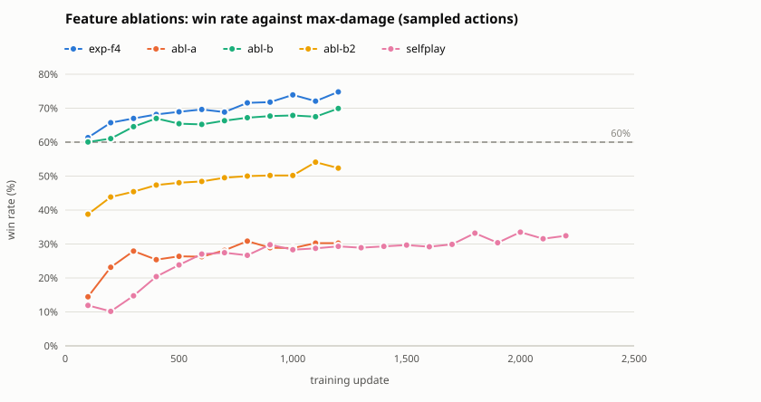
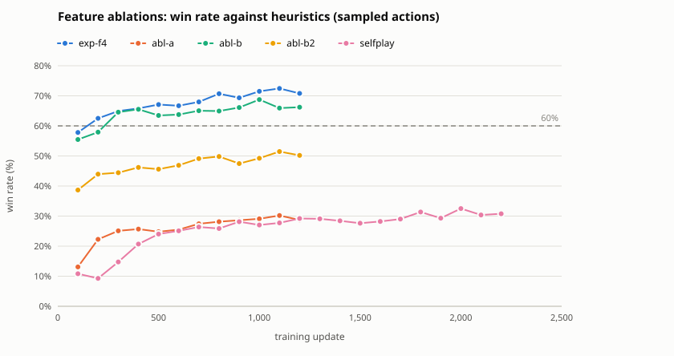

# Pokemon JAX

A JAX battle engine, RL environment and maskable Recurrent PPO for Pokemon
Showdown `gen5randombattle`. The plan and rules are in `ROADMAP.md`.

## Container

One image runs on the RTX 3060 Ti dev machine (Docker Desktop, WSL2 backend)
and on the RTX 6000 training machines (Docker with the NVIDIA Container
Toolkit). It has Python 3.13 with the pins from `requirements.txt` (JAX
0.12.0.1 for CUDA 13), Node 22, git, ripgrep, and two agent CLIs: Claude Code
(`claude`) and the Codex CLI (`codex`). The host needs an
NVIDIA driver that supports CUDA 13 (580 or newer); the CUDA libraries come
from pip. For a driver of 525 or newer (the lab's 550 hosts), build the CUDA 12 variant with
`--build-arg JAX_CUDA=cuda12`; `cuda12-driver550` pins the CUDA 12 libraries to older releases as a
fallback. The lab image is built with `--build-arg INSTALL_AGENTS=0`, which leaves out both agent CLIs.
The lab kit that runs on the RTX 6000 machines is described in `lab/README.md`.

Build (from the repo root):

```bash
docker build -t pokemon-jax .
```

Build arguments: `CLAUDE_CODE_VERSION` and `CODEX_VERSION` set the agent CLI
versions, and
`--build-arg USER_UID=$(id -u) --build-arg USER_GID=$(id -g)` on Linux makes
files written to the mounted repo belong to you.

Run with the repo mounted at `/workspace`. On Windows (PowerShell):

```powershell
docker run --rm -it --gpus all --mount "type=bind,source=K:\Pokemon JAX,target=/workspace" --mount "type=volume,source=pokemon-jax-claude,target=/home/developer/.claude" --mount "type=volume,source=pokemon-jax-codex,target=/home/developer/.codex" pokemon-jax
```

On Linux:

```bash
docker run --rm -it --gpus all --shm-size=2g -v "$(pwd)":/workspace -v pokemon-jax-claude:/home/developer/.claude -v pokemon-jax-codex:/home/developer/.codex pokemon-jax
```

Leave out `--gpus all` for CPU only; JAX then falls back to the CPU. The named
volumes keep the Claude Code and Codex logins between containers (sign in to
Codex with `codex login --device-auth`). The image sets no XLA allocator variable. The lab and `python -m pokejax.sizing` preallocate 90% of each GPU's memory per process (`XLA_PYTHON_CLIENT_PREALLOCATE=true`, `XLA_PYTHON_CLIENT_MEM_FRACTION=0.90`) unless you set those yourself; the tests set preallocation off. Other runs get JAX's default, or pass `-e XLA_PYTHON_CLIENT_PREALLOCATE=false` to share a GPU between processes.

Inside the container:

```bash
node reference/setup.cjs   # clone and build Showdown at the pinned commit
JAX_PLATFORMS=cuda python -c "import jax, jax.numpy as jnp; print(jax.devices()); print(jax.jit(lambda x: x @ x)(jnp.ones((256, 256))).devices())"
```

The second command fails instead of falling back to the CPU if JAX cannot see
the GPU. Expect one CUDA device on the dev machine.

## Environment

`pokejax/env.py` is the batched, functional environment (Phase 3). Host setup happens once in
the constructor; `reset` and `step` are pure, so they jit, vmap and scan:

```python
env = Env(EnvConfig(batch_size=4096, max_steps=1000, observe="both"), "work/teams/gen5-teams.npz")
env_state, timestep = jax.jit(env.reset)(key)
env_state, timestep = jax.jit(env.step)(env_state, actions)  # actions int [B, 2]
```

A battle that ends (win, loss, tie) or reaches the step cap is replaced inside the same step by
a fresh one with teams from the sampler. The time step has both sides' observations [B, 2, ...]
(`observe="none"` skips them), zero-sum rewards [B, 2] (win 1, loss -1, tie 0; optional
potential-based shaping with `shaping=True`), `terminated` and `truncated` [B], the observed
legal mask [B, 2, 9] and episode info (winner, length in steps and turns, illegal and refused
actions). `keep_final=True` also returns the observation before the reset. A hidden trap
(Shadow Tag, Arena Trap, Magnet Pull) refuses a switch as Showdown does: the step does not
advance, the refused side's mask loses its switches, and the other side's action is kept for the
next step. `OpponentEnv(env, opponent)` plays one random side per battle against a policy
function `(state, side, key) -> action` (random over the engine's legal mask by default) and
returns time steps of batch shape [B]. The module docstring has the details.

`pokejax/baselines.py` has four policies with that signature, chosen by name with
`make_policy(name, env.tables)`: `random` (uniform over the legal mask), `random-move` (uniform over the
legal moves, a switch only when none is legal), `max-damage` (power x STAB x effectiveness x accuracy x
hits x attack / defence, a switch only when it must) and `heuristics` (poke-env's
`SimpleHeuristicsPlayer`, commit bab3673). They are branch-free, read only what the player knows and
pick from the engine's true legal actions (hidden traps included), so none is ever refused. The
module docstring lists every interpretation of poke-env. `reference/baselines.cjs` is the same four
in Node, for `python -m pokejax.stats --policy0 NAME --policy1 NAME` and for the agreement check.

## Benchmarks

Run `python -m pokejax.bench --json` for the random legal policy, adding
`--batch-size 16384` to change the batch or `--with-observation` to observe
both sides. `--env` measures the environment of `pokejax.env` (sampler draws, auto-reset,
rewards, flags) with the random policy on both sides instead of the bare engine loop;
`--env --policy NAME` has both sides play that baseline from the state (`--policy1` gives side 1
another). The cold first call includes compilation and one rollout.

Measured 2026-11-17 on an NVIDIA GeForce RTX 3060 Ti, JAX 0.12.0.1,
HEAD `93a1b26fbbbd8bc0dbc527647b7a2bbc3e7ce7dd`:

| Batch | Mode | Cold first call (s) | Steps/s | Battles/s | Mean battle length (steps) |
|---:|---|---:|---:|---:|---:|
| 4,096 | Engine only | 4.65 | 25,134,430 | 355,907 | 70.70 |
| 16,384 | Engine only | 5.00 | 49,587,788 | 701,426 | 70.75 |
| 4,096 | Both observations | 5.05 | 12,374,399 | 175,471 | 70.70 |

The first row is the median of three fresh processes: cold first calls ranged
from 4.63 to 4.78 s, steps/s from 24,853,781 to 25,367,994, and battles/s
from 351,933 to 359,215. Each process reports the median of three warmed
rollouts. Cold compile under 60 s: pass. Engine throughput at batch 4,096
against the 5,000,000 steps/s target: pass.

In Phase 1, status moves, abilities and items do nothing, so later phases will
be slower.

### Phase 1 results

The differential tests passed the 40-battle fixture and the 300-battle set
(2 tests passed). The existing PPO smoke test won 3,883 of 4,096 battles
against random (94.80%, 95% Wilson CI 94.08–95.44%); random against random
won 50.95% (95% CI 49.42–52.48%). Training took 136.01 s and 9,830,400
environment steps.

### Phase 2 results

Gates, measured 2026-11-20 on an idle NVIDIA GeForce RTX 3060 Ti, JAX 0.12.0.1, with the
Phase 2 exit code (`python -m pokejax.bench --json`, batch 4,096, engine only, median of three
fresh processes, after performance pass 7): 3,419,031 steps/s (runs 3,404,191 to 3,425,404),
48,183 battles/s, mean battle length 70.99 steps, cold first call 29.05 s (29.01 to 29.20 s).
Cold compile under 60 s: pass. Engine throughput against the 3,000,000 steps/s target: pass
(the target was 5,000,000 until the owner lowered it at the end of Phase 2; see ROADMAP.md,
Gates). Throughput fell from 7.62M after performance pass 4 to 3.32M as tasks 11 to 14 added
the remaining mechanics. Performance pass 5 recovered 4%; a structural attempt (pass 6, a
working copy of the active Pokemon) did not help and was not committed; pass 7 (move identity
before row loads, prepared team inputs, shared damage facts) gained 3% and cut compile time.
The CPU cold compile at batch 64 is about 125 s.

Coverage (`COVERAGE.md`, generated): all 223 moves, 126 abilities and 44 items in the
10,000-team pool are supported, so 100.0% of teams are fully supported. The excluded set is
empty (0 teams, 0.0%). The team sampler (`pokejax/sampler.py`) draws only from supported
teams and computes its index array once on the host.

Differential recordings on unchanged pool teams: the 40-battle fixture
`tests/fixtures/diff-pool.jsonl.gz` matches 40 of 40 battles (2,609 decisions) and the
300-battle set `work/diff/pool.jsonl.gz` matches 300 of 300 (21,526 decisions). The other
fixtures and 300-battle sets still match completely. `python -m pytest -q tests --large`
passes 374 tests; `node --test tests/test-record-battles.cjs` passes 18.

Statistics (`python -m pokejax.stats --battles 4000 --unchanged --seed N`, pool teams exactly
as generated): with seed 1 and with seed 2 no statistic is flagged after Holm correction
(341 metrics each). The smallest raw p-values are 0.041 (seed 1, `move.agility`) and 0.064
(seed 2, `move.seedflare`). Showdown and the engine agree on side 0's win rate (Showdown
0.505 and engine 0.491 with seed 1; 0.504 and 0.497 with seed 2), mean battle length (Showdown
61.9 and engine 61.5 turns with seed 1; 62.3 and 62.3 with seed 2), faints per battle (9.95
and 9.98; 9.93 and 9.96) and status counts.

PPO smoke test (`python -m pokejax.ppo_smoke`, default configuration, 600 updates,
9,830,400 environment steps): the trained policy won 3,754 of 4,096 battles against random
(91.65%, 95% Wilson CI 90.76–92.46%); random against random won 49.88% (48.35–51.41%). Training
took 188.9 s on the RTX 3060 Ti, with no illegal actions.

### Phase 3 results

Gates, measured 2026-11-21 on an idle NVIDIA GeForce RTX 3060 Ti, JAX 0.12.0.1, with the
Phase 3 exit code, batch 4,096, median of three fresh processes each. Phase 3 exit measurement,
environment steps per second without observations (`python -m pokejax.bench --json --env --policy P`,
sampler draws, auto-reset, rewards and policy P on both sides):

| Policy on both sides | Steps/s | Runs | Mean battle length (steps) |
|---|---:|---|---:|
| random | 3,067,270 | 3,066,048 to 3,079,595 | 71.31 |
| random-move | 3,041,462 | 3,034,812 to 3,051,893 | 43.90 |
| max-damage | 3,025,314 | 3,020,785 to 3,026,324 | 27.46 |
| heuristics | 3,016,411 | 3,012,282 to 3,019,419 | 27.65 |

Each baseline runs at the 3,000,000 steps/s target: pass, with the thinnest margin 0.5%
(heuristics). The engine alone (`python -m pokejax.bench --json`) runs 3,077,254 steps/s
(3,072,321 to 3,096,411; 3,419,031 at the end of Phase 2). It lost 5% to the event record and
observation state of task 1 and 6% to the 41 engine defects fixed between tasks 1 and 2 (found by
fresh recordings with new seeds; see `tests/test_regress.py`). With both sides observed the
environment (random policies) runs 2,243,745 steps/s. Cold first call: 32.7 to 33.8 s, 35.3 s with
observations; cold compile under 60 s: pass.

Observation (tasks 1 and 2). `observe` shows what one player can know at a decision point: the
own team in full, the opponent as revealed, both actives' public volatiles, weather, hazards, Trick
Room, pending Wish and Healing Wish, and a fixed record of the last step's visible events (action
order, move, miss, failure, critical hit, effectiveness, damage and healing in protocol percent, status,
faint). Durations that the protocol never states are not in it, only the turns since a public effect
started. The no-leak tests check that two states differing only in unrevealed opponent data or private
counters give the same observation. `reference/player-view.cjs` builds the same observation from one
player's requests and protocol lines alone, and `pokejax/obs_diff.py` compares every leaf with the
engine's at every decision point of recorded pool battles, for both sides: the 40-battle fixture
(2,649 decision points), the 300-battle set (21,826) and four more 300-battle seeds match completely.
The comparison found and fixed leaks (a benched foe's HP after Regenerator, Shadow Tag, Arena Trap and
Magnet Pull in the legal mask, a Transformed member's copied stats) and missing public facts (Knock Off,
Trick and stolen items). Illusion is the one carve-out: once the foe's Illusion holder has been active
(about 2.5% of battles) the protocol does not say which roster entry a disguised switch-in is, so the
opponent roster arrays of the two sides can legitimately differ and are not compared there.

Environment (task 3). `Env` runs a batch of battles with teams from the sampler and replaces a battle that
ended or hit the step cap inside the same step. It returns both sides' observations (or none),
zero-sum rewards (win 1, loss -1, tie 0; optional potential-based shaping, off by default),
`terminated` and `truncated` kept apart, the observed legal mask and episode statistics. A switch that
only a hidden trap forbids is refused as Showdown refuses it. `OpponentEnv` plays one random side per
battle against a policy function. The PPO smoke test (`python -m pokejax.ppo_smoke`, 600 updates,
9,830,400 environment steps) runs on it: the trained policy won 3,658 of 4,096 battles against random
(89.31%, 95% Wilson CI 88.32-90.22%); random against random won 49.56% (48.03-51.09%). Training took
222.2 s on the RTX 3060 Ti, with no illegal actions.

Baselines (task 4). The four policies of `pokejax/baselines.py` and the Node ones of
`reference/baselines.cjs` agree exactly. At every decision point of recorded unchanged pool battles
(`node reference/record-battles.cjs --profile pool --policies`) the Node max-damage and heuristics
policies choose an action for both sides from that player's own view, and `pokejax.baselines_diff`
replays the battle through the engine and compares it with the JAX choice: 0 of 10,596 choices differ
over the 40-battle fixture (`tests/fixtures/policy-pool.jsonl.gz`) and 0 of 87,304 over the 300-battle
set; no choice fell back to a random pick. Ties between candidates go to the first in request order
(Showdown's `side.pokemon` order, which `BattleState.party` tracks), so the check is sensitive to it:
ascending team slots instead make 29 choices of the fixture differ. Interpretations of poke-env that the
policies make, beyond the brief: Hidden Power counts as the typed power 70 move (the Gen 5 table row has
power 0), the entry-hazard branch sees only Spikes and Toxic Spikes, ties are scores within 1e-5, and the
setup-move branch is ported but off because poke-env's `move.target == "self"` compares an enum with a
string and is never true at the pinned commit. Enabling it in both implementations still agrees
(0 of 87,304); it changes 227 of the 5,298 heuristics choices of the fixture (4%).

Whole-battle statistics on the unchanged pool teams (`python -m pokejax.stats --battles 4000 --unchanged
--seed N --policy0 A --policy1 B`, the same team pairs in both simulators). Side 0's win rate in
Showdown and in the engine, and the two-proportion test of the difference:

| Side 0 against side 1 | Seed | Showdown | Engine | Difference (SE) | p | Turns Showdown / engine | Flagged (metrics) |
|---|---:|---:|---:|---:|---:|---:|---|
| random-move against random | 1 | 0.9235 | 0.9193 | +0.0042 (0.0060) | 0.48 | 38.60 / 38.38 | none (337) |
| random-move against random | 2 | 0.9187 | 0.9163 | +0.0025 (0.0062) | 0.68 | 38.60 / 38.71 | none (340) |
| max-damage against random | 1 | 0.9812 | 0.9832 | -0.0020 (0.0030) | 0.50 | 24.64 / 24.45 | none (338) |
| max-damage against random | 2 | 0.9842 | 0.9832 | +0.0010 (0.0028) | 0.72 | 24.82 / 24.69 | none (339) |
| heuristics against random | 1 | 0.9850 | 0.9858 | -0.0008 (0.0027) | 0.78 | 24.27 / 23.93 | none (337) |
| heuristics against random | 2 | 0.9872 | 0.9875 | -0.0003 (0.0025) | 0.92 | 24.30 / 24.34 | none (339) |
| heuristics against max-damage | 1 | 0.5268 | 0.5225 | +0.0043 (0.0112) | 0.70 | 18.43 / 18.40 | none (336) |
| heuristics against max-damage | 2 | 0.5140 | 0.5235 | -0.0095 (0.0112) | 0.40 | 18.63 / 18.75 | none (337) |

No metric of any run is flagged after Holm correction (battle length, its distribution, faints,
switches, Struggle, confusion, statuses, and the use counts of every move and consumed item). The
smallest raw p-values are 0.018 to 0.087 (one per run, a different metric each time: for example
`status.par` 0.044 with seed 1 for max-damage against random, which is 0.81 with seed 2). Random
against random, for the Phase 2 comparison, is under Phase 2 results.

### Phase 4 results

Exit check (ROADMAP.md, Phase 4): beats max-damage in well over half of evaluation games, and the
training curve is still improving. The chosen run, `configs/rtx3060ti.toml`, won 76.49% of 4,096
battles against max-damage with sampled actions (95% Wilson CI 75.17 to 77.76) and 78.64% with greedy
actions (77.36 to 79.87). Against heuristics it won 75.00% and 76.83%. The curve rose from 70.6% at
update 2,000 to 76.8% at update 4,000 (1,024 battles per point), but the last 1,000 updates gained
about 1.7 points against a CI of about plus or minus 3, so the late rise is a slope, not a confirmed
trend (see "Still improving" below).

Setup (run directory `work/runs/rtx3060ti`, outside git; console log `work/codex/runs/rtx3060ti-console.log`):

- Configuration: `configs/rtx3060ti.toml`, run with `XLA_PYTHON_CLIENT_PREALLOCATE=true
  XLA_PYTHON_CLIENT_MEM_FRACTION=0.90` (the lab's allocator settings; the default allocator ran out of
  memory at 2,048 rows in the experiments).
- Network: GRU core of 256, trunk of 256, member encoder of 64, 741,659 parameters. Public damage and
  matchup features (`network.features`: each move slot's power, accuracy, STAB, type effectiveness
  against the opponent's current types and max-damage score; each switch's matchup and threat; the
  threat to the active member) and a per-action policy head (`network.action_head = "factored"`: one
  scorer for the move slots and one for the switches, width 64).
- Rows: 1,024 battle rows per update: 384 self-play (768 lanes), 256 pool rows (a pool of 8 past
  parameter sets, refreshed every 50 updates), 64 random, 64 random-move, 128 max-damage and 128
  heuristics. 1,408 learner lanes.
- Rollout 64 steps, sequences of 16, 4 epochs of 4 minibatches, learning rate 1e-3 decaying linearly
  to 1e-4 over the run (4,000 updates), gamma 0.99, GAE lambda 0.95, clip 0.2, entropy coefficient 0.01.
- Throughput (median of the update times, 4,000 updates): 78,383 environment steps per second of
  training (65,536 steps per update); the environment alone (random legal actions, no network) runs 401,159 steps per second on the same
  settings. The first update, which compiles, took 61.7 s.
- GPU memory: 1.60 GB peak (`peak_bytes_in_use`).
- Wall time: 3,620 s of training, including the 16 evaluations (every 250 updates, 1,024 battles per
  baseline and policy) and the checkpoints, then about 2 minutes for the final evaluation of 4,096
  battles per baseline and policy.

Evaluation curve (win rate %, sampled / greedy, 1,024 battles per cell):

| Update | random | random-move | max-damage | heuristics |
|---:|---|---|---|---|
| 250 | 98.5 / 99.1 | 89.5 / 92.4 | 64.2 / 68.7 | 62.9 / 64.6 |
| 500 | 98.9 / 99.1 | 91.1 / 93.1 | 67.6 / 70.6 | 65.1 / 67.9 |
| 750 | 99.1 / 99.4 | 92.1 / 93.8 | 68.6 / 69.9 | 65.0 / 68.7 |
| 1000 | 99.1 / 99.4 | 92.2 / 94.4 | 69.7 / 72.1 | 66.1 / 68.4 |
| 1250 | 99.2 / 99.5 | 93.1 / 95.1 | 67.9 / 72.7 | 66.0 / 70.9 |
| 1500 | 99.2 / 99.0 | 95.1 / 95.9 | 71.9 / 72.8 | 70.0 / 71.4 |
| 1750 | 98.5 / 99.6 | 93.9 / 96.3 | 71.6 / 73.9 | 70.1 / 71.0 |
| 2000 | 99.6 / 99.2 | 93.8 / 95.2 | 70.6 / 72.3 | 68.7 / 72.4 |
| 2250 | 98.9 / 99.0 | 95.6 / 96.4 | 72.5 / 72.9 | 71.5 / 71.9 |
| 2500 | 98.9 / 99.4 | 94.8 / 96.4 | 74.3 / 73.2 | 71.1 / 71.5 |
| 2750 | 99.2 / 99.4 | 94.3 / 96.6 | 73.4 / 74.3 | 69.9 / 73.8 |
| 3000 | 98.7 / 99.2 | 94.4 / 95.4 | 75.1 / 76.2 | 72.9 / 74.3 |
| 3250 | 98.8 / 99.6 | 95.0 / 95.7 | 75.4 / 76.7 | 73.1 / 76.3 |
| 3500 | 99.4 / 99.8 | 95.3 / 96.5 | 76.0 / 77.1 | 73.5 / 75.2 |
| 3750 | 99.1 / 99.6 | 96.5 / 96.5 | 75.8 / 76.1 | 74.2 / 75.5 |
| 4000 | 99.3 / 99.8 | 96.6 / 96.7 | 76.8 / 77.7 | 75.7 / 77.7 |

Final evaluation (4,096 battles per row; learner sides alternate; Wilson 95% intervals):

| Opponent | Policy | Win rate % | 95% Wilson CI % | Wins / battles |
|---|---|---:|---|---:|
| heuristics | greedy | 76.83 | 75.51 to 78.10 | 3147 / 4096 |
| heuristics | sampled | 75.00 | 73.65 to 76.30 | 3072 / 4096 |
| max-damage | greedy | 78.64 | 77.36 to 79.87 | 3221 / 4096 |
| max-damage | sampled | 76.49 | 75.17 to 77.76 | 3133 / 4096 |
| random | greedy | 99.58 | 99.34 to 99.74 | 4079 / 4096 |
| random | sampled | 99.29 | 98.99 to 99.51 | 4067 / 4096 |
| random-move | greedy | 96.02 | 95.38 to 96.58 | 3933 / 4096 |
| random-move | sampled | 95.63 | 94.96 to 96.21 | 3917 / 4096 |

The plot of the curve against max-damage and heuristics (sampled, with the 60% exit target) is
`docs/phase4-curve.svg`.

Still improving. The curve against max-damage (sampled) reads 70.6% at update 2,000,
75.1% at 3,000, 76.0% at 3,500, 75.8% at 3,750 and 76.8% at 4,000; against heuristics it reads
68.7%, 72.9%, 73.5%, 74.2% and 75.7%. Both rose over the run, and the
learning rate reached its floor at the end. Over the last 1,000 updates the rise is about
1.7 points against max-damage, inside the CI of a 1,024-battle point
(about plus or minus 3). We report it as a slope, not as a confirmed trend: the 4,096-battle
evaluation is the figure to quote.

A longer decay did not help by 2,000 updates. A first run with the same settings but a 12,000-update decay
(`work/runs/rtx3060ti-h12000-stopped`, stopped at update 2,210) kept the rate near 9e-4 for thousands of
updates: its curve against max-damage was 71.9% (sampled) at 1,000 updates, 70.1% at 1,500 and 68.6% at 2,000,
with KL growing from 0.004 to 0.013 per update and the clip fraction from 0.035 to 0.077. The 4,000-update
decay (the chosen run) reached 75.1% at 3,000 updates. The stopped run is kept in work/ and is not
evaluated further.

Diagnosis (before the change). The 2,200-update self-play run (`configs/selfplay.toml`, the part 2
run) stalled at 26% to 34% against max-damage from update 600 on. Its training logs say the update was
small (approximate KL 0.0003 to 0.003 per update, clip fraction 0.002 to 0.02), the entropy fell from
1.77 to 0.33, and the explained variance held near 0.6. Replaying its checkpoint against max-damage
(`work/codex/diag/diag_policy.py`, decision by decision, with the max-damage choice and the public damage
numbers for the same position) gave these numbers, which also show what the change did:

| Diagnostic, greedy, 512 rows x 300 steps (about 5,000 battles) | selfplay, 2,200 updates | E4, 1,200 updates | chosen, 4,000 updates |
|---|---:|---:|---:|
| learner win rate in these battles | 35.2% | 76.7% | 79.0% |
| move chosen equal to max-damage's move, when both pick a move | 48.0% | 70.2% | 63.2% |
| policy's top action equal to max-damage's action | 43.9% | 64.5% | 58.2% |
| probability the policy gives max-damage's action (mean) | 0.44 | 0.59 | 0.53 |
| super-effective share of move choices (max-damage: 29.1%, 35.9%, 35.3%) | 13.1% | 36.1% | 33.1% |
| resisted or immune move chosen when a neutral or super option exists | 20.5% | 4.1% | 5.9% |
| chosen move's max-damage score over the best legal one (mean) | 0.64 | 0.73 | 0.68 |
| pairs of moves ordered the same way by the policy logits and max-damage scores | 0.69 | 0.74 | 0.71 |
| status move chosen when a damaging move is legal | 15.4% | 19.6% | 25.1% |
| voluntary switches (max-damage: never) | 2.5% | 11.8% | 11.7% |
| voluntary switches to the best legal matchup | 46% | 81% | 81% |

Reading. The network saw the moves only as 16-dimensional embeddings of their IDs, so the product of
power, type, STAB, accuracy and the boosted attack ratio had to be built by the trunk from scratch; it
partly managed (ordering agreement 0.69), but it used super-effective moves about half as often as max-damage
and switched almost never. With the public damage and matchup features as inputs, and a head that scores
each move slot and each switch from its own features, the same agent picks max-damage's move in about
two of three positions and uses super-effective moves nearly as often as max-damage does.
The learning rate was the second bottleneck: at 3e-4 the approximate KL per update was about 0.001, and the
run at 1e-3 reached 67% against max-damage at 300 updates against 63% at 3e-4 (experiments E3 and E4).

Experiments (one seed, 1,024 battles per point, so differences under about 3 points are noise). Each short
run is about 1,200 updates (20 to 25 minutes on the RTX 3060 Ti); the trials that were stopped early are
marked. The final column is the run's own 4,096-battle evaluation.

| Run | What changed from `selfplay.toml` | Updates (minutes) | max-damage at 300 / 600 / 1,000 (sampled / greedy) | Final max-damage, 4,096 battles (sampled / greedy) | Final heuristics (sampled / greedy) |
|---|---|---:|---|---|---|
| E0 `selfplay.toml` | none (dense head, lr 3e-4 to 3e-5, 1,024 rows) | 2,200 (30.6) | 14.7 / 15.8, 27.1 / 27.5, 28.3 / 30.1 | 31.9 / 32.1 | 30.9 / 31.9 |
| E1 | features and factored head | 1,200 (22.2) | 63.1 / 63.7, 65.2 / 67.2, 67.7 / 66.5 | 68.0 / 70.0 | 65.1 / 68.5 |
| E2 | E1 with 2,048 rows | 810, stopped (26.5) | 64.2 / 66.8, 66.7 / 67.6, (800: 69.4 / 68.0) | not run to the end | not run to the end |
| E3 | E1 with max-damage and heuristics at 12.5% each (selfplay 37.5%) | 1,200 (21.1) | 63.1 / 64.7, 65.6 / 67.0, 68.6 / 68.4 | 68.1 / 70.4 | 65.4 / 68.6 |
| E4 | E3 with lr 1e-3 to 1e-4 | 1,200 (21.1) | 67.0 / 67.1, 69.6 / 70.7, 73.9 / 75.6 | 74.9 / 77.2 | 72.2 / 74.3 |
| E5 | E3 with lr 2e-3 to 2e-4 | 1,060, stopped (19.0) | 63.8 / 65.8, 65.9 / 70.7, 66.7 / 72.0 | not run to the end | not run to the end |
| L1 | E4 with a 12,000-update decay | 2,210, stopped (34.9) | 66.2 / 69.8, 71.9 / 73.0 (1,000), 68.6 / 71.2 (2,000) | not run to the end | not run to the end |
| L2 (chosen) | E4 with a 4,000-update decay: `configs/rtx3060ti.toml` | 4,000 (62) | 64.2 / 68.7, 69.7 / 72.1, 75.1 / 76.2 (3,000) | 76.5 / 78.6 | 75.0 / 76.8 |

The 2,048-row run (E2) gave the same curve per update at 1.8 times the time per update, so 1,024 rows
stayed. Raising the max-damage and heuristics shares (E3) changed nothing measurable, but kept those
groups at 128 rows each, so it stayed. Raising the learning rate to 2e-3 (E5) was worse than 1e-3 by
the 1,000-update point. The chosen setup is E4's, with a 4,000-update decay.

Lab kit (lab/README.md). The smoke test with the RTX 6000 configuration on this 8 GB card (`LAB_SMOKE=1
lab/run.sh`, `configs/rtx6000.toml`): preflight, facts, bench (3 measurements) and the sweep (1 cell, batch 1,024) completed; contention and the training probe ran out of memory at 16,384, 8,192 and 4,096 rows, since one allocation of the 4,096-row arena is above the 3 to 4 GiB this card allows (the part 1 finding), so the lab stopped those steps as its fallback ladder ends there. The pack step wrote `work/lab-results/2026-11-22-fee70b24e9c5-5.tar.gz`, and the lab exited 1 with "lab run not complete", which the brief accepts for this card. On the RTX 6000 the first rung, 16,384 rows, is the one expected to run.

Caveats. The features read the observation only, so no hidden information enters them, and tests cover that
(`tests/test_train_features.py`). One exception to matching max-damage: Hidden Power's type depends on
the Pokemon's IVs, which the observation does not carry, so the features count it as a Normal move of
power 70. The max-damage scores agree with the baseline to 1e-4 everywhere else (checked on real battles).
The evaluation battles use fixed keys, so every checkpoint of a run plays the same battles.

### Feature ablations

Question: how much of the Phase 4 result comes from the two kinds of column the owner asked about, the max-damage score of each move and poke-env's matchup estimate of each switch? Four runs of E4 differ only in the network's inputs. A has no public features and the dense head (the network of E0). `dex` (B) keeps the move table and the public types, and each switch's legality, HP, offence and defence estimates; it drops the max-damage scores, the speed, matchup and threat columns and the active member's threat. `dex-no-matchup` (B2) also drops the switches' offence and defence. The inputs are chosen by `network.feature_set` (`full` by default, so no existing configuration changed; the columns are in `pokejax/train/features.py`). Each run is 1,200 updates with the settings of E4 (the E3 opponent shares, learning rate 1e-3 decaying to 1e-4, 1,024 rows, rollouts of 64 steps, seed 0), evaluated every 100 updates with 1,024 battles and finally with 4,096 battles per row. The configurations are `work/codex/exp/abl-a.toml`, `abl-b.toml` and `abl-b2.toml`; the run directories `work/runs/abl-a`, `abl-b` and `abl-b2` (outside git). C is E4 itself (`work/runs/exp-f4`, not rerun), and E0 (`work/runs/selfplay`) is shown for reference with its own settings.

| Run | Inputs | Final vs max-damage, 4,096 battles: sampled / greedy (95% Wilson interval) | Final vs heuristics | Final vs random-move | Final vs random | Max-damage at 300 / 600 / 1,000 / 1,200 (sampled / greedy) | Training minutes | Parameters |
|---|---|---|---|---|---|---|---:|---:|
| A (`abl-a`) | none, dense head | 32.03 (30.62 to 33.48) / 32.84 (31.42 to 34.29) | 31.18 (29.78 to 32.61) / 31.57 (30.16 to 33.01) | 80.27 (79.03 to 81.46) / 81.76 (80.55 to 82.92) | 97.24 (96.69 to 97.70) / 98.46 (98.04 to 98.80) | 27.93 / 25.59 · 26.27 / 28.81 · 28.81 / 29.49 · 30.27 / 33.50 | 17.9 | 686,882 |
| B (`abl-b`) | `dex` (move table, public types, PP, HP; switch legal and HP, offence, defence), factored head | 70.85 (69.44 to 72.22) / 74.51 (73.15 to 75.82) | 68.97 (67.54 to 70.37) / 71.75 (70.35 to 73.11) | 93.99 (93.22 to 94.68) / 94.80 (94.08 to 95.44) | 99.22 (98.90 to 99.45) / 99.54 (99.28 to 99.70) | 64.55 / 68.75 · 65.23 / 68.36 · 67.87 / 72.27 · 69.92 / 73.93 | 21.4 | 733,851 |
| B2 (`abl-b2`) | `dex-no-matchup` (as B, switch legal and HP only), factored head | 54.47 (52.94 to 55.99) / 56.67 (55.14 to 58.18) | 53.42 (51.89 to 54.94) / 55.15 (53.62 to 56.67) | 92.21 (91.35 to 92.99) / 90.82 (89.90 to 91.67) | 98.85 (98.48 to 99.14) / 99.37 (99.07 to 99.57) | 45.41 / 48.14 · 48.44 / 51.95 · 50.20 / 53.03 · 52.34 / 55.08 | 22.4 | 731,163 |
| C = E4 (`exp-f4`) | all columns (max-damage scores, matchup estimates, threat), factored head | 74.93 (73.58 to 76.23) / 77.20 (75.89 to 78.46) | 72.24 (70.85 to 73.59) / 74.29 (72.93 to 75.61) | 95.26 (94.57 to 95.87) / 95.36 (94.67 to 95.96) | 99.17 (98.84 to 99.41) / 99.34 (99.04 to 99.55) | 66.99 / 67.09 · 69.63 / 70.70 · 73.93 / 75.59 · 74.80 / 76.46 | 21.1 | 741,659 |
| E0, reference (`selfplay`) | none, dense head; its own settings (2,200 updates, lr 3e-4 to 3e-5) | 31.86 (30.45 to 33.30) / 32.10 (30.69 to 33.55) | 30.88 (29.49 to 32.32) / 31.93 (30.52 to 33.38) | 81.69 (80.48 to 82.84) / 82.35 (81.15 to 83.49) | 97.61 (97.09 to 98.03) / 97.83 (97.33 to 98.23) | 14.75 / 15.82 · 27.05 / 27.54 · 28.32 / 30.08 · 29.30 / 28.81 | 30.6 | 686,882 |





The points are evaluations (1,024 battles, sampled actions); the dashed line is 60%. Colours are fixed per run: C (`exp-f4`) blue, A (`abl-a`) orange, B (`abl-b`) aqua, B2 (`abl-b2`) yellow and E0 (`selfplay`) magenta. No run is still rising beyond the noise at 1,200 updates: the last three evaluation points against max-damage (sampled, 1,000 / 1,100 / 1,200) are A 28.8, 30.3, 30.3; B 67.9, 67.5, 69.9; B2 50.2, 54.1, 52.3; C 73.9, 72.1, 74.8.

Without the public features, on the dense head, the agent stays at about 32% against max-damage (E0: 31.9%), against 54.5% with the move and type inputs alone (B2) and 70.9% with the switch offence and defence estimates too (B). The max-damage scores and the other estimate columns add about 4 points more (C, 74.9%), and the switch offence and defence estimates add about 16 on top of the move and type inputs (B over B2). A and B also differ in the action head, and each arm is one seed, so these are the sizes of the effects, not a clean split between inputs and head.

### Phase 5 results

The Phase 4 checkpoint (`work/runs/rtx3060ti`) played in the pinned local Showdown simulator through
the bridge (`reference/showdown-player.cjs`, `python -m pokejax.showdown`) against the Node
baselines, next to the engine's evaluation of the same checkpoint on the same team pairs and learner
sides (`python -m pokejax.showdown.compare --checkpoint work/runs/rtx3060ti --battles 4096`). 4,096
battles per row, JAX on the CPU (the GPU was in use), Wilson 95% intervals.

| Opponent | Policy | Engine win % | Showdown win % | Difference (points) |
|---|---|---|---|---:|
| random | sampled | 99.29 [98.99, 99.51] | 99.73 [99.52, 99.85] | +0.44 |
| random | greedy | 99.58 [99.34, 99.74] | 99.58 [99.34, 99.74] | +0.00 |
| random-move | sampled | 95.63 [94.96, 96.21] | 95.90 [95.25, 96.46] | +0.27 |
| random-move | greedy | 96.02 [95.38, 96.58] | 96.66 [96.06, 97.16] | +0.63 |
| max-damage | sampled | 76.56 [75.24, 77.83] | 77.17 [75.86, 78.43] | +0.61 |
| max-damage | greedy | 78.56 [77.28, 79.79] | 78.83 [77.56, 80.06] | +0.27 |
| heuristics | sampled | 75.05 [73.70, 76.35] | 75.05 [73.70, 76.35] | +0.00 |
| heuristics | greedy | 76.68 [75.36, 77.95] | 77.29 [75.99, 78.55] | +0.61 |

Exit: within 3 points against each baseline with at least 4,000 battles a side; the largest gap is
0.63 points, so it passes. Over all 32,768 Showdown battles: 0 errors, 0 disagreements between the
observed legal mask and Showdown's request, 0 truncations; refused trapped switches 3.6 to 5.1 per 100
battles, the same size as in the engine; mean battle length within 0.3 steps. The first observation of
every battle matches the engine's leaf for leaf (floats within 1 ulp: XLA divides by multiplying with
a reciprocal). Showdown is ahead by +0.35 points on average (6 of 8 rows positive, none negative);
individually only random/sampled is significant (p = 0.003). On the GPU the same comparison gave a
largest gap of 1.51 points. Showdown battles run at about 45 per second in one Node process.
